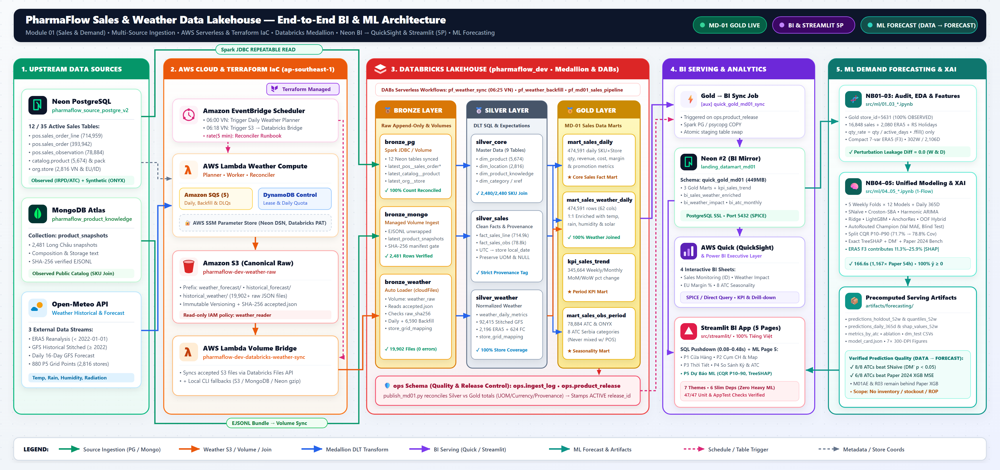

<div align="center">

# 💊 PharmaFlow — Sales & Weather Data Lakehouse (BI Pipeline)

**End-to-End Pharmaceutical Retail Sales & Weather Data Engineering Platform for Business Intelligence**

[](https://www.python.org/)
[](https://www.databricks.com/)
[](https://neon.tech/)
[](https://www.mongodb.com/)
[](https://aws.amazon.com/)
[](https://www.terraform.io/)
[](#-bi-serving--analytics-layer-aws-quick--power-bi)
[](#-5-chạy-dashboard-streamlit-multipage-4-trang-tiếng-việt)

<p>
  <a href="#-tổng-quan-dự-án">Tổng quan</a> •
  <a href="#-kiến-trúc-hệ-thống-system-architecture">Kiến trúc</a> •
  <a href="#-quy-mô-dữ-liệu-đã-kiểm-chứng">Quy mô dữ liệu</a> •
  <a href="#-cấu-trúc-thư-mục">Cấu trúc thư mục</a> •
  <a href="#-thiết-lập-môi-trường--credentials">Credentials</a> •
  <a href="#-hướng-dẫn-vận-hành">Vận hành</a> •
  <a href="#-tài-liệu--tham-khảo">Tài liệu</a>
</p>

</div>

---

## 🎯 Tổng quan dự án

**PharmaFlow Sales & Weather Data Lakehouse** là hệ thống đường ống dữ liệu (**Data Engineering & Business Intelligence Pipeline**) hoàn chỉnh cho mảng **Phân tích Bán hàng Dược phẩm (Sales Analytics)** trên đa thị trường (Việt Nam, Indonesia, Châu Âu/Serbia).

Dự án giải quyết bài toán tích hợp dữ liệu đa nguồn có cấu trúc khác nhau (Relational POS, Document Product Catalog, External Weather Time-Series) thông qua hạ tầng đám mây **AWS Serverless** (quản lý bằng **Terraform IaC**), xử lý chuẩn hóa qua 3 phân tầng **Medallion Lakehouse (Bronze → Silver → Gold)** trên **Databricks**, và cung cấp Data Mart sẵn sàng cho **Business Intelligence (AWS QuickSight / Power BI)** với mức chi phí vận hành tối ưu (**$0/tháng** trên các tầng Free/Serverless).

### ✨ Điểm nổi bật của hệ thống
- 🔄 **Multi-Source Heterogeneous Ingestion:** Kết hợp đồng thời nguồn quan hệ **Neon PostgreSQL**, nguồn tài liệu bán cấu trúc **MongoDB Atlas** và nguồn API thời tiết **Open-Meteo (ERA5 + GFS)**.
- ☁️ **Production-Grade AWS IaC:** Toàn bộ S3 Bucket, IAM Least-Privilege Policies, DynamoDB Control State, 5 SQS Queues, 4 Lambda Functions và EventBridge Scheduler được quản lý hoàn toàn bằng **Terraform** kèm bộ test `.tftest.hcl`.
- 🧱 **Databricks Asset Bundles (DABs) & Lakeflow DLT:** Triển khai Pipeline khai báo (Declarative SQL + PySpark) với quy tắc kiểm soát chất lượng dữ liệu (*Expectations*), giữ nguyên ngữ nghĩa đơn vị tính (`UOM`), múi giờ địa phương (`local_date`), và phân tách rạch ròi nguồn gốc dữ liệu (`OBSERVED` vs `SYNTHETIC` vs `UNVERIFIED`).
- 🛡️ **Atomic Reconciliation Gate:** Chốt phát hành dữ liệu qua bảng kiểm soát `ops.product_release`, đối soát khớp 100% số lượng và doanh thu giữa tầng Silver và tầng Gold trước khi mở cho tầng BI.
- 📊 **Automated BI Serving Layer:** Đồng bộ tự động Gold Sales Marts sang **Neon BI Mirror** (`landing_datamart_md01`) kèm 3 Analytical Views tối ưu sẵn cho **AWS QuickSight (SPICE / Direct Query)** và **Power BI**.
- 🎛️ **4-Page Vietnamese Streamlit BI Dashboard:** Ứng dụng **Streamlit + Plotly** tại `src/streamlit/` tái hiện và nâng cấp bố cục 4 trang của AWS Quick (*Tổng Quan*, *Thời Tiết & Địa Điểm*, *Cửa Hàng & Lợi Nhuận*, *Sản Phẩm & ATC*), hỗ trợ **4 bảng màu tự chọn**, bản đồ Châu Âu (Choropleth ISO-3), lọc chéo ô thời tiết, xuất CSV UTF-8 và **SQL aggregation pushdown** trực tiếp trên PostgreSQL (phản hồi `0.08–0.48s`/query, không kéo 474K dòng về RAM).

---

## 🏗 Kiến trúc hệ thống (System Architecture)

> 🖼️ Xem phiên bản vector độ phân giải vô hạn tại: [pharmaflow-sales-bi-architecture.svg](docs/images/pharmaflow-sales-bi-architecture.svg)

<div align="center">
  
</div>

### 🔍 Diễn giải luồng dữ liệu theo 4 phân vùng

| Phân vùng | Thành phần chính | Vai trò & Cơ chế hoạt động |
| :--- | :--- | :--- |
| **1. Upstream Data Sources** | 🐘 **Neon PostgreSQL v2**<br/>🍃 **MongoDB Atlas**<br/>🌤️ **Open-Meteo API** | • **PostgreSQL (`pharmaflow_source_postgre_v2`):** Chứa 12/35 bảng Sales/Catalog/Store đang hoạt động (giao dịch bán lẻ IRPD quan sát, dữ liệu tổng hợp Onyx & Pharma Sales).<br/>• **MongoDB (`product_snapshots`):** Lưu 2.481 bản chụp tri thức dược phẩm Long Châu (thành phần, hướng dẫn bảo quản) với chỉ mục SHA-256 duy nhất.<br/>• **Open-Meteo:** Cung cấp chuỗi thời tiết lịch sử (ERA5 `< 2022`, GFS Stitched `≥ 2022`) và dự báo 16 ngày cho **880 điểm lưới** đại diện 2.816 nhà thuốc. |
| **2. AWS Cloud & Terraform IaC** | ⏰ **EventBridge**<br/>⚡ **AWS Lambda (x4)**<br/>📬 **SQS** & 🗄️ **DynamoDB**<br/>🪣 **Amazon S3**<br/>🔐 **AWS SSM** | • **06:00 VN:** EventBridge kích hoạt **Lambda Planner** đọc tọa độ từ Neon (qua `SSM SecureString`), chia cụm lưới `0.111°`, đẩy task vào **SQS**.<br/>• **Lambda Worker:** Điều phối tải từ Open-Meteo (kèm giới hạn quota ở **DynamoDB**), lưu bytes gốc vào **S3** kèm `accepted.json` và `SHA-256`.<br/>• **06:18 VN:** EventBridge kích hoạt **Lambda Volume Bridge** đồng bộ các tệp `accepted.json` mới từ S3 sang **Databricks Managed Volume** qua Files API. |
| **3. Databricks Lakehouse** | 🥉 **Bronze Layer**<br/>🥈 **Silver Layer**<br/>🥇 **Gold Layer**<br/>🛡️ **Ops Control** | • **Bronze:** `bronze_pg` (Spark JDBC `REPEATABLE READ` + Volume fallback), `bronze_mongo` (unwrap Extended JSON), `bronze_weather` (Auto Loader kiểm tra `raw_sha256`).<br/>• **Silver (DLT SQL):** `silver_core` (9 bảng Master Data), `silver_sales` (tách biệt `fact_sales_line` và `fact_sales_observation`, quy đổi `local_date`), `silver_weather` (chuẩn hóa metrics ngày).<br/>• **Gold (MD-01 Marts):** Xuất `mart_sales_daily`, `mart_sales_weather_daily` (join 1:1 thời tiết), `kpi_sales_trend`, `mart_sales_observation_period` và đóng dấu release tại `ops.product_release`. |
| **4. BI Serving & Analytics** | ⚡ **Auto-Sync Job**<br/>🐘 **Neon #2 BI Mirror**<br/>📊 **AWS Quick / Power BI**<br/>🎛️ **Streamlit BI App** | • Job `[aux] quick_gold_md01_sync` tự động lắng nghe cập nhật từ `ops.product_release`, thực hiện atomic table swap sang schema `quick_gold_md01` trên Neon #2.<br/>• Cung cấp **3 BI Helper Views** không tốn thêm dung lượng (`bi_sales_weather_enriched`, `bi_weather_impact_summary`, `bi_atc_category_monthly`) cho **4 Dashboard Sheets** trên AWS QuickSight / Power BI.<br/>• Ứng dụng **Streamlit Multipage (`src/streamlit/`)** truy vấn SQL pushdown trực tiếp Neon #2, hiển thị 100% tiếng Việt với 4 bảng màu tùy chọn. |

---

## 📊 Quy mô dữ liệu đã kiểm chứng

Toàn bộ pipeline đã được triển khai, chạy live trên **Databricks Free Edition (`pharmaflow_dev`)** và **AWS (`ap-southeast-1`)** với các chỉ số thực tế sau:

| Layer / Thành phần | Bảng / Đối tượng chính | Số lượng bản ghi / Tệp | Ghi chú kiểm chứng |
| :--- | :--- | ---: | :--- |
| **Upstream Postgres** | `pos.sales_order_line` / `pos.sales_order` | `714,959` / `393,942` | 100% đối soát khớp giữa source và `bronze_pg` |
| **Upstream Postgres** | `pos.sales_observation` | `78,884` | Chuỗi tổng hợp theo kỳ (ONYX 62,036 + ATC 16,848) |
| **Upstream Postgres** | `catalog.product` / `org.store` | `5,674` / `2,816` | Bao phủ Long Châu VN, IRPD Indonesia, ONYX EU |
| **Upstream MongoDB** | `product_snapshots` | `2,481` | 2,480/2,480 sản phẩm ánh xạ thành công sang `dim_product` |
| **AWS S3 & Weather** | Raw Open-Meteo JSON (`weather_raw`) | `19,902` files | 0 lỗi checksum; hoàn tất 6,590 backfill tasks + P5 grid |
| **Silver Weather** | `silver_weather.weather_daily_metrics` | `95,235` rows | 92,415 GFS Stitched + 2,196 ERA5 + 624 Forecast daily |
| **Gold Sales Mart** | `gold_md01_sales.mart_sales_daily` | `474,591` rows | Doanh số, giá vốn, biên lợi nhuận, khuyến mãi theo ngày |
| **Gold Enriched** | `gold_md01_sales.mart_sales_weather_daily` | `474,591` rows | **100% độ phủ thời tiết** trên toàn bộ dòng bán lẻ |
| **Gold Period KPI** | `gold_md01_sales.kpi_sales_trend` | `345,664` rows | Tổng hợp theo Tuần / Tháng kèm `%` tăng trưởng kỳ trước |
| **BI Mirror (Neon #2)** | `quick_gold_md01.*` + 3 Helper Views | `449 MB` | Sẵn sàng cho AWS QuickSight SPICE & Direct Query |

---

## 📁 Cấu trúc thư mục

```text
.
├── .env.example                            # Mẫu cấu hình biến môi trường (không chứa secret)
├── .gitignore                              # Quy tắc bảo vệ credentials, state Terraform & cache
├── requirements.txt                        # Dependencies Python 3.12+
├── README.md                               # Tài liệu tổng quan dự án
│
├── docs/                                   # 📚 Tài liệu thiết kế, kiến trúc & nghiên cứu
│   ├── images/                             # Sơ đồ kiến trúc tổng quan (.png & .svg)
│   ├── architecture/                       # Tài liệu kiến trúc hệ thống, Data Products & Weather Plan
│   ├── data-model/Relations-DataSource/    # Data Dictionary & sơ đồ EERD của PostgreSQL Source v2
│   ├── design/databricks-medallion/        # Thiết kế chi tiết 3 lớp Bronze/Silver/Gold (MDD_vKiro)
│   ├── domain/sales-and-demand/            # Đặc tả nghiệp vụ Module 01 (UR/FR, Use Case, Activity, Sequence)
│   ├── reviews/                            # Báo cáo kiểm định kiến trúc Pipeline SDD
│   └── references/papers/                  # Tài liệu & bài báo khoa học tham khảo
│
├── scripts/
│   └── weather/                            # 🛠 Scripts đóng gói & deploy AWS Lambda Weather (PowerShell)
│
├── src/
│   ├── synthetic_data_source/              # 🗄️ Tầng chuẩn bị & kiểm chứng Nguồn dữ liệu
│   │   ├── pharmaflow_source_postgre/      # DDL 35 bảng, mapping, CLI nạp & verify Neon PostgreSQL v2
│   │   └── mongodb/                        # Contract validator & importer MongoDB product_snapshots
│   │
│   ├── weather/                            # 🌤️ Engine thu thập thời tiết Open-Meteo (CLI + AWS Lambda)
│   │   ├── config/                         # Cấu hình biến thời tiết ERA5 / GFS v1 & cohorts
│   │   └── *.py                            # Planner, Worker, Reconciler, Grid P5, Validation, S3 Storage
│   │
│   ├── infra/terrafrom/                    # ☁️ Infrastructure as Code (AWS ap-southeast-1)
│   │   ├── bootstrap/                      # Khởi tạo S3 remote state bucket
│   │   ├── modules/private_s3/             # Module bảo mật S3 bucket chuẩn doanh nghiệp
│   │   └── environments/dev/               # S3 bucket, IAM policies, Weather compute & Databricks bridge
│   │
│   ├── pipeline/databricks/                # 🧱 Databricks Asset Bundle (DABs) — Medallion MD-01
│   │   ├── databricks.yml                  # Cấu hình workspace & targets (dev Serverless / prod)
│   │   ├── SDD.md                          # Software Design Document chi tiết
│   │   ├── resources/                      # Định nghĩa Workflows (jobs.yml) & DLT Pipelines (pipelines.yml)
│   │   ├── src/
│   │   │   ├── common/                     # Shared Databricks host sanitizer & Volume helpers
│   │   │   ├── bronze/                     # JDBC/Volume sync, Lambda bridge, Auto Loader weather & mongo
│   │   │   ├── silver/                     # DLT SQL: core.sql, sales.sql, weather.sql
│   │   │   ├── gold/                       # DLT SQL: md01_sales.sql
│   │   │   └── ops/                        # publish_md01.py (đối soát & đóng dấu release)
│   │   └── tests/                          # Unit tests offline cho toàn bộ Databricks logic
│   │
│   ├── streamlit/                          # 🎛️ Dashboard BI Multipage (Streamlit + Plotly, 4 trang tiếng Việt)
│   │   ├── app.py                          # Điểm chạy chính (st.navigation + shared sidebar state)
│   │   ├── config.py                       # 4 bảng màu tùy chọn, metadata track & bộ ánh xạ tiếng Việt
│   │   ├── queries.py                      # Bộ sinh SQL pushdown tham số hóa an toàn (%s)
│   │   ├── db.py                           # Kết nối Neon (-pooler) qua psycopg + @st.cache_data
│   │   ├── ui.py                           # Giao diện KPI cards, Plotly layout helpers & xuất CSV
│   │   ├── components/filters.py           # Bộ lọc toàn cục phân tầng đồng bộ qua st.session_state
│   │   └── pages/01..04_*.py               # 4 trang: Tổng Quan, Thời Tiết, Cửa Hàng, Sản Phẩm & ATC
│   │
│   └── sync_quick/                         # 📊 BI Serving Bridge: Gold MD-01 → Neon #2 → AWS QuickSight
│       ├── sync_gold_to_neon.py            # Sync atomic staging swap & tạo 3 BI Helper Views
│       ├── setup_databricks_aux_sync.py    # Deploy job tự động lắng nghe ops.product_release
│       └── test_sync_quick.py              # Unit tests tầng BI sync
│
└── tests/
    ├── test_streamlit_dashboard.py         # ✅ Bộ 21 unit & AppTest kiểm thử toàn bộ Dashboard Streamlit
    └── weather/                            # ✅ Bộ 142 unit tests kiểm thử hệ thống Weather Ingestion
```

---

## 🔐 Thiết lập môi trường & Credentials

### 1. Yêu cầu tiên quyết (Prerequisites)
* **Python:** `3.12+`
* **AWS CLI v2** (`aws login` / SSO profile) & **Terraform `1.16+`** (nếu triển khai hạ tầng AWS)
* **Databricks CLI (`v1.26+`)** (cài đặt qua `winget` / `brew` để chạy Asset Bundles)

### 2. Cài đặt môi trường ảo Python
```powershell
python -m venv .venv
.\.venv\Scripts\Activate.ps1
pip install -r requirements.txt
```

### 3. Hướng dẫn xin & cấu hình Credentials (`.env`)
Sao chép file mẫu `.env.example` thành `.env` ở thư mục gốc và điền thông tin từ các dịch vụ tương ứng (**tuyệt đối không commit file `.env` hay `.streamlit/secrets.toml`**):

```powershell
Copy-Item .env.example .env
```

> **Phân quyền nhanh cho thành viên trong team:**
> * **Chỉ chạy Dashboard Streamlit (`src/streamlit/app.py`) hoặc notebook phân tích trên Gold:** Chỉ cần **Python `3.12+`** và **2 biến** `QUICK_NEON_DATABASE_URL` + `QUICK_NEON_SCHEMA=quick_gold_md01` (nên cấp role PostgreSQL **chỉ đọc `SELECT`** trên `quick_gold_md01`, không cần AWS, Databricks hay MongoDB).
> * **Vận hành / phát triển toàn bộ Pipeline (Ingestion, Weather, Databricks, Sync):** Cần đủ 5 nhóm biến trong `.env`, cài thêm **AWS CLI v2** (`aws login`), **Databricks CLI / PAT**, **Terraform** (nếu chỉnh IaC), và được **whitelist IP** trên **MongoDB Atlas Network Access**.

<details>
<summary><b>📋 Bảng hướng dẫn chi tiết cách lấy từng loại Credential</b></summary>

| Nhóm biến | Dịch vụ | Cách lấy / Cấp quyền |
|---|---|---|
| `DATABASE_URL_UNPOOLED`<br/>`WEATHER_NEON_DSN` | **Neon PostgreSQL #1** | Lấy từ **Neon Console → Connection Details**. `WEATHER_NEON_DSN` nên dùng role chỉ có quyền `SELECT` trên `org.store` (`weather_reader`) để tuân thủ nguyên tắc tối thiểu quyền. |
| `MONGODB_CONNECTION_STRING`<br/>`USERNAME_MONGODB`<br/>`PASSWORD_MONGODB` | **MongoDB Atlas** | Tạo Database User trong **Atlas → Database Access** (quyền `readWrite` trên DB `pharmaflow_product_knowledge`) và lấy SRV URI tại **Connect → Drivers**. |
| `WEATHER_S3_BUCKET`<br/>`WEATHER_S3_ROLE_ARN`<br/>`WEATHER_AWS_PROFILE` | **AWS Cloud** | Đăng nhập AWS CLI bằng `aws login --profile my-aws` (hoặc SSO). Lấy tên bucket và ARN của role `pharmaflow-dev-weather-local-writer` từ lệnh `terraform output` tại `src/infra/terrafrom/environments/dev`. |
| `DATABRICKS_HOST`<br/>`DATABRICKS_TOKEN` | **Databricks** | Lấy Workspace URL (`https://dbc-xxxx.cloud.databricks.com` — không kèm query params) và tạo Personal Access Token (PAT) trong **Databricks User Settings → Developer → Access tokens**. |
| `QUICK_NEON_DATABASE_URL`<br/>`QUICK_NEON_SCHEMA` | **Neon BI Mirror #2** | Tạo một project Neon riêng cho tầng BI (`landing_datamart_md01`), lấy **Pooled connection string** (`-pooler`) để kết nối với Databricks và AWS QuickSight. |

</details>

---

## 🚀 Hướng dẫn vận hành

### 1. Chạy toàn bộ Unit Tests (Offline — không cần kết nối cloud)
```powershell
# 1. Kiểm thử Databricks Lakehouse & Lambda Bridge (17 tests)
.\.venv\Scripts\python.exe -B -m pytest src\pipeline\databricks\tests -v -p no:cacheprovider

# 2. Kiểm thử Weather Ingestion Engine (142 tests)
.\.venv\Scripts\python.exe -B -m pytest tests\weather -v -p no:cacheprovider

# 3. Kiểm thử BI Serving Sync Bridge (6 tests) & Dashboard Streamlit (21 tests)
.\.venv\Scripts\python.exe -B -m pytest src\sync_quick\test_sync_quick.py tests\test_streamlit_dashboard.py -v -p no:cacheprovider

# 4. Kiểm thử Contract nguồn dữ liệu Postgres & MongoDB
.\.venv\Scripts\python.exe -B -m pytest src\synthetic_data_source\mongodb\test_product_knowledge.py -v -p no:cacheprovider
.\.venv\Scripts\python.exe -B -m pytest src\synthetic_data_source\pharmaflow_source_postgre\tests\test_forecast_source_contract.py -v -p no:cacheprovider

# 5. Kiểm thử hạ tầng Terraform IaC (nếu đã cài Terraform)
terraform -chdir=src/infra/terrafrom/environments/dev test
```

### 2. Vận hành Data Sources & Weather Ingestion
```powershell
# Kiểm tra kết nối và đối soát dữ liệu nguồn PostgreSQL
.\.venv\Scripts\python.exe -B src\synthetic_data_source\pharmaflow_source_postgre\scripts\source_cli.py verify all --database pharmaflow_source_postgre_v2

# Kiểm tra kết nối MongoDB Atlas
.\.venv\Scripts\python.exe -B src\synthetic_data_source\mongodb\check_connection.py

# Kiểm tra Weather Preflight & chạy thu thập lên S3
.\.venv\Scripts\python.exe -B -m src.weather.cli preflight --sink s3
```

### 3. Đồng bộ Volume & Chạy Databricks Pipeline (DABs)
```powershell
# Đồng bộ Weather S3 & MongoDB sang Databricks Managed Volume (nếu dùng Free Edition)
.\.venv\Scripts\python.exe -B src\pipeline\databricks\src\bronze\sync_s3_to_volume.py --mode daily
.\.venv\Scripts\python.exe -B src\pipeline\databricks\src\bronze\sync_mongo_to_volume.py --run-id lc-longchau-full-20261105-02

# Validate, Deploy & Trigger Databricks Asset Bundle
cd src/pipeline/databricks
databricks bundle validate -t dev
databricks bundle deploy -t dev
databricks bundle run pf_weather_sync -t dev
databricks bundle run pf_md01_pipeline -t dev
```

### 4. Đồng bộ Gold Marts sang Neon BI Mirror & Kết nối AWS QuickSight
```powershell
# Kiểm tra trạng thái bản phát hành Gold hiện tại (dry-run)
.\.venv\Scripts\python.exe -B src\sync_quick\sync_gold_to_neon.py --mode local --dry-run

# Đồng bộ Gold MD-01 sang Neon BI Mirror (tự động tạo 3 BI Helper Views)
.\.venv\Scripts\python.exe -B src\sync_quick\sync_gold_to_neon.py --mode local
```

Sau khi đồng bộ xong, mở **Amazon QuickSight (AWS Quick)** → **New Dataset → PostgreSQL**:
- **Connection type:** `Public network` | **Port:** `5432` | **SSL:** `Enabled`
- **Datasets khả dụng:** `bi_sales_weather_enriched`, `bi_weather_impact_summary`, `kpi_sales_trend`, `bi_atc_category_monthly`
- Xem chi tiết bộ **4 Prompt tạo Dashboard Sheets tự động** tại [src/sync_quick/README.md](src/sync_quick/README.md).

### 5. Chạy Dashboard Streamlit Multipage (4 Trang Tiếng Việt)
Chỉ cần có `.venv` và 2 biến `QUICK_NEON_DATABASE_URL`, `QUICK_NEON_SCHEMA` trong `.env`:

```powershell
.\.venv\Scripts\streamlit.exe run src\streamlit\app.py --server.port 8501
```

Truy cập `http://localhost:8501` để sử dụng 4 trang (**Tổng Quan**, **Thời Tiết & Địa Điểm**, **Cửa Hàng & Lợi Nhuận**, **Sản Phẩm & ATC**), chuyển đổi 4 bảng màu giao diện, lọc đa yếu tố thời tiết và tải CSV trực tiếp. Xem chi tiết tại [src/streamlit/README.md](src/streamlit/README.md).

---

## 📖 Tài liệu & Tham khảo

* **Hướng dẫn Dashboard Streamlit (4 trang):** [src/streamlit/README.md](src/streamlit/README.md)

* **Software Design Document (SDD) Databricks Pipeline:** [src/pipeline/databricks/SDD.md](src/pipeline/databricks/SDD.md)
* **Thiết kế 3 tầng Medallion Lakehouse:** [docs/design/databricks-medallion/02-thiet-ke-medallion.md](docs/design/databricks-medallion/02-thiet-ke-medallion.md)
* **Kiến trúc Hệ thống & Data Products:** [docs/architecture/pharmaflow-system-architecture.md](docs/architecture/pharmaflow-system-architecture.md) | [pharmaflow-data-products.md](docs/architecture/pharmaflow-data-products.md)
* **Thiết kế Weather Ingestion (SDD & Runbook):** [src/weather/SDD.md](src/weather/SDD.md) | [src/weather/README.md](src/weather/README.md)
* **Hướng dẫn Hạ tầng AWS Terraform:** [src/infra/terrafrom/README.md](src/infra/terrafrom/README.md)
* **Từ điển dữ liệu Nguồn PostgreSQL v2:** [docs/data-model/Relations-DataSource/README.md](docs/data-model/Relations-DataSource/README.md)
* **Đặc tả nghiệp vụ Sales & Demand (MD-01):** [docs/domain/sales-and-demand/REQUIREMENTS_SALES_DEMAND_LANDSCAPE_V1.md](docs/domain/sales-and-demand/REQUIREMENTS_SALES_DEMAND_LANDSCAPE_V1.md)
