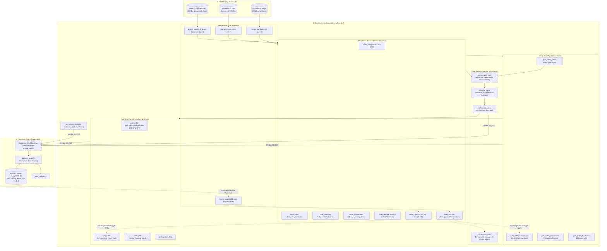
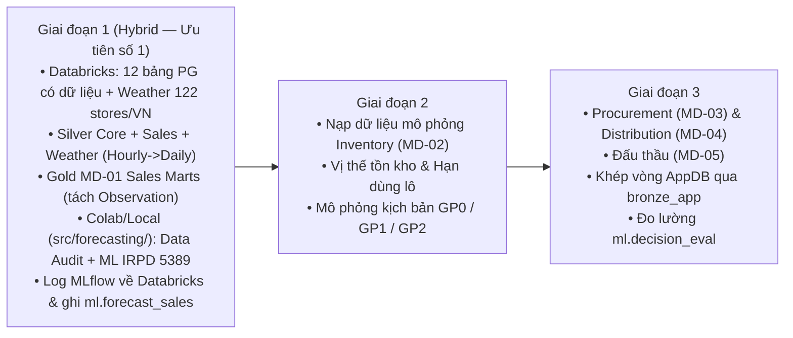

# Software Design Document (SDD): PharmaFlow Databricks Lakehouse & ML Pipeline (`src/pipeline/databricks`)

> [!IMPORTANT]
> **Trạng thái tài liệu:** `v1.4 - HYBRID PHASE 1 (MD-01 MART) & FREE EDITION VOLUME BRIDGE`  
> Tài liệu này là **đặc tả thiết kế chi tiết** dùng làm kim chỉ nam triển khai mã nguồn và nghiệm thu phân hệ Databricks Lakehouse.  
> - `v1.1` (16/11): Khắc phục 6 phát hiện P0 và P1 từ audit ([REVIEW.md](../../../artifacts/reviews/2026-11-16-pipeline-sdd/REVIEW.md)).  
> - `v1.2` (17/11): Bổ sung hợp đồng P5 Grid Clustering (`store_grid_mapping.json`).  
> - `v1.3` (17/11): Bổ sung chế độ **Databricks Free Edition Bridge** (AWS S3 là canonical store, đồng bộ sang Unity Catalog Managed Volume qua Databricks Files API; tách pipeline Weather `pf_weather_sync` chạy độc lập).  
> - `v1.4` (17/11): Chốt mô hình **Hybrid cho Giai đoạn 1** (Databricks xử lý Bronze $\rightarrow$ Silver $\rightarrow$ Gold Mart MD-01; **Colab / Local `src/forecasting/`** chạy Data Audit, Densification và ML Training/Backtesting, log MLflow về Databricks và ghi kết quả dự báo ngược lại Unity Catalog `ml.*`). Đồng bộ hợp đồng 12/35 bảng Neon đang có dữ liệu và xử lý weather lịch sử (`weather_asof_valid`).

- **Phiên bản thiết kế:** v1.4
- **Ngày cập nhật:** 2026-11-17 (chốt kiến trúc Hybrid Phase 1 + hợp đồng dữ liệu thực tế Neon v2)
- **Thư mục triển khai:** `src/pipeline/databricks/` (và nhánh ML Hybrid tại [src/forecasting/](../../forecasting/))
- **Tài liệu căn cứ & liên kết:**
  - Thiết kế Medallion Lakehouse gốc: [jobs/W9.11/MDD_vKiro/02-thiet-ke-medallion.md](../../../jobs/W9.11/MDD_vKiro/02-thiet-ke-medallion.md)
  - Quy trình kỹ thuật Databricks: [jobs/W9.11/MDD_vKiro/04-quy-trinh-ky-thuat-databricks.md](../../../jobs/W9.11/MDD_vKiro/04-quy-trinh-ky-thuat-databricks.md)
  - Đặc tả chính sách tồn kho MD-02: [jobs/W2.11/FEFO_AND_INVENTORY_POLICY_SPEC_V1.md](../../../jobs/W2.11/FEFO_AND_INVENTORY_POLICY_SPEC_V1.md)
  - Thiết kế Platform AppDB & Hợp đồng đồng bộ: [jobs/W9.11/DBD/01-kien-truc-va-quan-he-databricks.md](../../../jobs/W9.11/DBD/01-kien-truc-va-quan-he-databricks.md)
  - Hợp đồng thu thập Weather: [src/weather/SDD.md](../../weather/SDD.md), [sync_s3_to_volume.py](src/bronze/sync_s3_to_volume.py), [aws_volume_sync_lambda.py](src/bronze/aws_volume_sync_lambda.py), [src/weather/grid.py](../../weather/grid.py), [src/weather/planner.py](../../weather/planner.py) và [src/weather/worker.py](../../weather/worker.py)
  - Kiến trúc hệ thống tổng thể: [docs/architecture/pharmaflow-system-architecture.md](../../../docs/architecture/pharmaflow-system-architecture.md)

---

## 1. Trạng thái & Phân định ranh giới trách nhiệm

### 1.1. Bảng phân loại bằng chứng và trạng thái hệ thống
Để tránh ngộ nhận giữa thiết kế đề xuất và thành phần đã hoạt động thực tế trong repository:

| Thành phần | Trạng thái hiện tại | Bằng chứng kiểm chứng |
|---|---|---|
| **Weather Pipeline (`src/pipeline/databricks/`)** | `VERIFIED (Daily Live Free Edition)` | Đã có `databricks.yml`, `resources/jobs.yml` (`pf_weather_sync`, `pf_weather_backfill`), `resources/pipelines.yml` (`pf_silver_weather`), `weather_autoloader.py`, `silver/weather.sql`, `sync_s3_to_volume.py`, `aws_volume_sync_lambda.py` (11/11 unit tests pass + chạy live `pf_weather_sync` thành công). |
| **Sales & Gold MD-01 Pipeline** | `VERIFIED (Phase 1 Live Free Edition)` | Đã triển khai & chạy live `pf_md01_sales_pipeline` (`bronze_pg`, `bronze_mongo`, `pf_silver_core`, `pf_silver_sales`, `pf_gold_md01`, `publish_md01`): `mart_sales_daily` (`474.591`), `mart_sales_observation_period` (`78.884`), `kpi_sales_trend` (`345.664`), `mart_sales_weather_daily` (`474.591`), `ops.product_release` (`md01-413415570405548`, 17/17 unit tests pass tại `src/pipeline/databricks/tests/`). |
| **Nguồn PostgreSQL (`pharmaflow_source_postgre_v2`)** | `IMPLEMENTED (12/35 bảng có dữ liệu)` | DDL 35 bảng tại `schema_full.sql`; `final-verification.json` xác nhận 12 bảng `catalog/org/pos` đã nạp đủ (~715k sales lines, 78,8k obs, 2.816 stores); 23 bảng `inventory/procurement` hiện `0` dòng. |
| **Nguồn MongoDB** | `IMPLEMENTED (Local Package)` | Importer, contract và test offline 11/11 pass tại `src/synthetic_data_source/mongodb/`. |
| **Nguồn Weather Raw** | `DEPLOYED P5 (AWS Dev)` | Đã hoàn tất 100% Backfill lịch sử (122 store quốc tế, 6.590 tasks), đóng Gate P4, và deploy P5 `full_network` (`0.111° floor` -> 880 điểm = 2.816 cửa hàng, 142+ tests pass). |
| **ML Engine (`src/forecasting/` / Colab Hybrid)** | `PROPOSED DESIGN` | `src/forecasting/` hiện chỉ có `.gitkeep`; chạy Hybrid bên ngoài Databricks sau Gold MD-01, log MLflow về Databricks. |
| **Platform AppDB** | `PROPOSED TARGET DESIGN` | DDL địa phương 59 bảng tại `jobs/W9.11/DBD/appdb_schema_full.sql`; chưa có live deployment. |

### 1.2. Ranh giới trách nhiệm (Invariants)
1. **Bản chất hệ thống:** PharmaFlow là hệ thống hỗ trợ ra quyết định chuỗi cung ứng (**Decision Support System - DSS**), **không thay thế** ERP, WMS, POS hay hệ thống quản trị bệnh viện (HIS).
2. **Chuỗi giá trị bất biến:**
   $$\mathbf{DATA \longrightarrow FORECAST \longrightarrow RISK \longrightarrow DECISION \longrightarrow OPERATIONAL\ OUTCOME}$$
3. **Phân tách hai lớp đánh giá:** Tuyệt đối tách biệt **Chất lượng dự báo (Prediction Quality)** với **Chất lượng quyết định (Decision Quality)**. Dự báo có sai số thấp hơn không đồng nghĩa quyết định tồn kho tốt hơn.
4. **Bảo toàn nguồn gốc dữ liệu (Provenance):** Mọi bản ghi xuyên suốt từ Bronze $\rightarrow$ Silver $\rightarrow$ Gold phải phân biệt rõ ràng: `OBSERVED` (quan sát thực tế), `SYNTHETIC` (sinh mô phỏng có kiểm soát), hoặc `UNVERIFIED` (chưa kiểm chứng).
5. **Con người duyệt quyết định (Human-in-the-loop):** Mọi đề xuất quan trọng (mua hàng, điều chuyển kho, dự thầu) phải thông qua người có thẩm quyền phê duyệt trên Web Platform; Lakehouse không tự ý phát hành PO hay lệnh điều chuyển thật ra hệ thống ngoài.

---

## 2. Kiến trúc tổng thể & Chu trình dữ liệu 2 chiều

Hệ thống hoạt động theo mô hình **vòng lặp khép kín hai chiều** giữa **Databricks Lakehouse (OLAP / ML Engine)** và **Platform AppDB (OLTP / Workflow State)**:



---

## 3. Thiết kế chi tiết Tầng Bronze (Raw Ingestion)

### 3.1. Nạp Weather từ S3 / Managed Volume (`src/bronze/weather_autoloader.py`) — [Khắc phục F01]
> [!WARNING]
> Tuyệt đối không quét thư mục `daily_forecast` hoặc lọc `DAILY_FORECAST` vì sai lệch hoàn toàn với producer trong code `src/weather/planner.py`.

* **Chế độ nguồn đọc theo môi trường (`weather_raw_root`):**
  - **Dev (`Databricks Free Edition` — cầu nối tự động S3 → Managed Volume, cập nhật 17/11/2026):** Do Free Edition không hỗ trợ cross-account AWS IAM Role Storage Credential / External Location, AWS S3 (`pharmaflow-dev-weather-raw-522346104596-ap-southeast-1`) vẫn là **canonical raw store**. Hệ thống triển khai Lambda riêng **`pharmaflow-dev-databricks-weather-sync`** ([aws_volume_sync_lambda.py](src/bronze/aws_volume_sync_lambda.py), IaC tại [databricks_bridge.tf](../../infra/terrafrom/environments/dev/databricks_bridge.tf)) gắn policy chỉ-đọc `weather_reader` + đọc SSM `/pharmaflow/dev/databricks/weather_sync_pat`, chạy tự động theo lịch **`06:18 VN`** (lọc `recent_days = 2`) để đẩy các tệp `accepted.json`, `response`, `metadata`, `store_grid_mapping.json`, `summary` lên **`/Volumes/pharmaflow_dev/bronze_weather/weather_raw/open_meteo/`** (trước lịch `pf_weather_sync` lúc `06:25 VN`); kèm CLI local [sync_s3_to_volume.py](src/bronze/sync_s3_to_volume.py) dùng cho backfill lịch sử hoặc đồng bộ tay.
  - **Paid AWS / Production (Target Design):** Kết nối trực tiếp **`s3://pharmaflow-dev-weather-raw-522346104596-ap-southeast-1/raw/open_meteo/`** qua Unity Catalog Storage Credential (`weather_reader_role_names` trong `main.tf`) và External Location (`Read-only`).
  - `weather_autoloader.py` nhận tham số cấu hình `weather_raw_root` để dùng chung một logic `cloudFiles` + `raw_sha256` cho cả hai chế độ.
* **Prefix tương đối bên dưới `<weather_raw_root>` (chính xác):**
  - Dự báo hàng ngày: `weather_forecast/` (trên S3 là `raw/open_meteo/weather_forecast/`, chế độ chạy `daily_forecast`).
  - Lịch sử ghép nối: `historical_forecast/` (trên S3 là `raw/open_meteo/historical_forecast/`, cho ngày $\ge 2022-01-01$).
  - Tái phân tích ERA5: `historical_weather/` (trên S3 là `raw/open_meteo/historical_weather/`, cho ngày $< 2022-01-01$).
* **Hợp đồng `source_type`:**
  - `FORECAST` (cho daily forecast 16 ngày tới).
  - `HISTORICAL_FORECAST_STITCHED` (cho backfill GFS).
  - `HISTORICAL_ERA5_REANALYSIS` (cho backfill ERA5).
* **Hợp đồng Grid Clustering P5 (`full_network` — cập nhật 17/11/2026):**
  - Với Daily `full_network` (880 tasks/ngày): **122 store quốc tế** giữ nguyên `metadata.store_id` nguyên; **2.694 store VN** được gom theo lưới `0.111° floor` thành **758 ô**, trong đó `metadata.json` mang `store_id = null`, `grid_id` (`grid:VN:floor:0.111:...`), `member_store_ids` (`ARRAY<INT>`) và `member_store_count`.
  - Đồng thời, mỗi run có gom cụm đều xuất thêm tệp **`<run_prefix>/store_grid_mapping.json`** liệt kê ánh xạ 1:1 `store_id` ↔ `(point_id, grid_id, task_id, store_latitude/longitude, point_latitude/longitude, provenance)` cho toàn bộ 2.816 cửa hàng.
  - `weather_autoloader.py` phải hỗ trợ cả `--mode daily` (`weather_forecast/`) và `--mode historical` (`historical_forecast/` + `historical_weather/`), nạp đồng thời `bronze_weather.raw_snapshots` (từ `accepted.json`) và `bronze_weather.store_grid_mapping` (từ `store_grid_mapping.json`).
* **Giao thức đọc có bảo vệ (Manifest-Driven Ingestion):**
  1. Auto Loader chỉ quét các tệp `accepted.json` tại `<weather_raw_root>/**/tasks/<task_id>/accepted.json`.
  2. Từ mỗi `accepted.json`, trích xuất 3 trường bắt buộc (`response_key`, `metadata_key`, `raw_sha256`), ánh xạ key S3 tương ứng sang đường dẫn dưới `weather_raw_root`.
  3. Chỉ nạp đúng 2 tệp được trỏ tới. **Bỏ qua toàn bộ attempt lỗi hoặc tệp rác mồ côi (orphan files)**.
  4. Tính mã băm SHA-256 trên byte đọc được từ tệp response và đối chiếu với `raw_sha256`. Nếu không khớp, đánh dấu `CORRUPTED` và ghi vào log lỗi, không nạp vào Bronze.

### 3.2. Nạp PostgreSQL Nguồn (`src/bronze/pg_snapshot.py` hoặc Volume Bridge) — [Khắc phục F04]
* **Phạm vi bảng Giai đoạn 1 (theo thực trạng Neon `pharmaflow_source_postgre_v2`):**
  - Toàn bộ schema nguồn có 35 bảng, nhưng hiện tại chỉ **12 bảng `catalog` / `org` / `pos` đang có dữ liệu** (`catalog.manufacturer`, `product`, `product_category`, `product_category_assignment`, `product_packaging`, `product_source_reference`, `unit_of_measure`, `org.store`, `org.warehouse`, `pos.sales_observation`, `pos.sales_order`, `pos.sales_order_line`).
  - 23 bảng thuộc `inventory.*`, `procurement.*`, `pos.customer_request*`, `pos.sales_channel` hiện `0` dòng $\rightarrow$ chưa bắt buộc nạp ở Giai đoạn 1 (để dành cho Giai đoạn 2–3 khi nạp dữ liệu sim).
* **Hai phương án đọc nguồn cho Free Edition vs AWS Paid:**
  - *Cách A (JDBC trực tiếp):* Job Python Spark đọc JDBC snapshot từ Neon (nếu Databricks Free Edition Serverless hỗ trợ outbound JDBC tới Neon).
  - *Cách B (Managed Volume Parquet Bridge — dự phòng chắc chắn cho Free Edition):* Script Python local đọc 12 bảng có dữ liệu từ Neon qua `psycopg`, ghi ra Parquet kèm `_ingest_run_id`, rồi upload lên `/Volumes/pharmaflow_dev/bronze_pg/pg_raw/` qua Databricks Files API (`databricks-sdk`) để Spark/DLT đọc trực tiếp không vướng mạng.
* **Giao thức Full Snapshot Append có Run Manifest:**
  1. Mỗi lần nạp snapshot định kỳ, sinh một UUID phiên chạy duy nhất (`run_id`).
  2. Ghi bản ghi phiên nạp vào `ops.ingest_log` với trạng thái `RUNNING`:
     `{run_id, source_system: 'POSTGRES', started_at, status: 'RUNNING'}`.
  3. Ghi append vào `bronze_pg.<schema>__<table>` kèm 4 cột kỹ thuật bắt buộc:
     * `_ingest_run_id` (`STRING`): Nhận diện đúng phiên nạp.
     * `_ingest_date` (`DATE`): Ngày nạp (dùng làm partition).
     * `_source_object` (`STRING`): Tên bảng nguồn gốc (`pos.sales_order_line`).
     * `_row_hash` (`STRING`): SHA-256 của các thuộc tính nghiệp vụ để nhận diện thay đổi.
  4. Sau khi đủ tập bảng của phase và đối chiếu khớp số lượng dòng với nguồn, cập nhật trạng thái `ops.ingest_log` thành `SUCCEEDED`.
  5. **Quy tắc an toàn cho tầng Silver:** Tầng Silver **chỉ được phép đọc** dữ liệu thuộc về `run_id` có trạng thái `SUCCEEDED` gần nhất (qua View/Pointer cập nhật sau khi `ops.ingest_log` chốt `SUCCEEDED`). Không bao giờ query toàn bảng Bronze để tránh nhân bản dữ liệu khi retry.

### 3.3. Nạp AppDB Feedback (`src/bronze/app_sync.py`) — [Khắc phục F07]
* Kết nối JDBC đọc-chỉ bằng user `dbx_app_reader`.
* **Cơ chế con trỏ gia tăng (Incremental Cursor):**
  - Bảng có thay đổi trạng thái (`review.*`, `ops.carrier_trip`): Quét theo cặp `(updated_at > last_watermark_time OR (updated_at = last_watermark_time AND id > last_watermark_id))`.
  - Bảng chỉ ghi thêm (Append-only: `review.proposal_feedback`, `ops.carrier_gps_ping`): Quét theo `id > last_watermark_id`.
* **Danh sách cấm (Security Blacklist):** Cấm tuyệt đối đọc `iam.app_user.password_hash`, bảng `iam.user_session`, và tệp nhị phân PDF trên S3.

---

## 4. Thiết kế chi tiết Tầng Silver (Standardization & Quality)

### 4.1. Chuẩn hóa Múi giờ & Thời gian — [Khắc phục F08]
> [!IMPORTANT]
> Không ép toàn bộ dữ liệu về múi giờ Việt Nam (`Asia/Ho_Chi_Minh`), vì các chuỗi nhà thuốc nguồn hoạt động ở các múi giờ khác nhau (IRPD: `Asia/Jakarta`, Onyx: Châu Âu, Pharma Sales: `Europe/Belgrade`).

* **Quy tắc lưu trữ thời gian:**
  1. Mọi mốc thời gian giao dịch/sự kiện giữ nguyên giá trị tuyệt đối ở cột `event_timestamp_utc` (`TIMESTAMP` UTC).
  2. Tạo cột ngày địa phương `local_date` (`DATE`) bằng cách chuyển đổi `event_timestamp_utc` theo đúng trường `org.store.timezone_name` của điểm bán tương ứng:
     ```sql
     local_date = CAST(from_utc_timestamp(event_timestamp_utc, store_timezone_name) AS DATE)
     ```
  3. Giờ Việt Nam (`Asia/Ho_Chi_Minh`) **chỉ dùng cho lịch điều phối batch chung** của toàn hệ thống Databricks.

### 4.2. Ràng buộc Chất lượng Dữ liệu (Lakeflow Expectations)
Áp dụng trực tiếp trong Declarative Pipelines (`src/silver/`):
```sql
-- Ràng buộc chất lượng bán lẻ (silver_sales.fact_sales_line)
CONSTRAINT pk_not_null EXPECT (sales_order_line_id IS NOT NULL) ON VIOLATION DROP ROW,
CONSTRAINT qty_positive EXPECT (sold_quantity > 0) ON VIOLATION DROP ROW,
CONSTRAINT valid_local_date EXPECT (local_date IS NOT NULL) ON VIOLATION DROP ROW,
CONSTRAINT has_provenance EXPECT (provenance_class IN ('OBSERVED', 'SYNTHETIC', 'UNVERIFIED')) ON VIOLATION FAIL UPDATE;

-- Ràng buộc chất lượng thời tiết (silver_weather.weather_snapshot)
-- Lưu ý: raw_payload được weather_autoloader.py đọc dạng binaryFile/UTF-8 raw bytes giữ nguyên từng byte gốc trước khi parse JSON.
CONSTRAINT valid_sha256 EXPECT (sha2(raw_payload, 256) = raw_sha256) ON VIOLATION FAIL UPDATE,
CONSTRAINT valid_source_type EXPECT (source_type IN ('FORECAST', 'HISTORICAL_FORECAST_STITCHED', 'HISTORICAL_ERA5_REANALYSIS')) ON VIOLATION DROP ROW;
```

### 4.3. Chuẩn hóa & Bung Lưới Thời tiết (`src/silver/weather.sql`) — [Bổ sung v1.2 / v1.4]
1. **Giải nén thời gian & đơn vị:** Parse `hourly` (44 biến GFS, riêng ERA5 `< 2022-01-01` là 35 biến — 9 biến GFS-only như `uv_index`, `visibility`, `cape`, `precipitation_probability` tự nhận giá trị `NULL` cho ERA5) và `daily` (5 biến) từ `raw_payload`. Chuyển `hourly.time` (Unix epoch UTC) sang `event_timestamp_utc` và tính `local_date` theo `metadata.timezone_requested` (không ép toàn bộ về giờ VN).
2. **Bung ô lưới ra đủ 2.816 cửa hàng (`silver_weather.weather_hourly` & `silver_weather.weather_daily`):**
   - Nếu `metadata.store_id IS NOT NULL` (122 store quốc tế hoặc pilot): giữ trực tiếp `store_id`.
   - Nếu `metadata.store_id IS NULL` (758 ô lưới VN của `full_network`): thực hiện **`LATERAL VIEW EXPLODE(metadata.member_store_ids)`** (và đồng bộ `bronze_weather.store_grid_mapping`) để tạo bản ghi chuẩn theo từng `store_id`, giữ `grid_id` để truy vết nguồn gốc cụm lưới.
   - Bảo toàn `retrieved_at_utc`, `source_type`, `coordinate_provenance`, `coordinate_verification_status`, kèm cờ `weather_asof_valid` (`TRUE` chỉ cho `FORECAST`, `FALSE` cho backfill lịch sử) để phục vụ nghiên cứu EDA và ML.
3. **Tổng hợp ngày từ `weather_hourly` & xử lý null đuôi ngày thứ 16:**
   - Các bản ghi `ACCEPTED_WITH_WARNINGS` của Open-Meteo GFS có thể chứa `null` ở cuối ngày thứ 16; tầng Silver gắn cờ `is_tail_partial` và **bắt buộc tổng hợp các chỉ số ngày (`temp_mean`, `temp_min`, `temp_max`, `humidity_mean`, `precip_sum`, `wind_speed_max`) trực tiếp từ `weather_hourly WHERE NOT is_tail_partial`** (vì Open-Meteo `daily` trong v1 chỉ lấy 5 biến đặc thù để tiết kiệm quota).

---

## 5. Thiết kế chi tiết Tầng Gold & Logic nghiệp vụ 5 Miền

### 5.1. MD-01: Sales & Demand Marts (`gold_md01_sales`) — [Ưu tiên Giai đoạn 1]
Đối chiếu thực tế `schema_full.sql`, `final-verification.json` và `config/sources/*.yaml`:
1. **Tách biệt rạch ròi 2 luồng dữ liệu doanh số (chống nhân đôi ONYX & Serbia):**
   - `gold_md01_sales.mart_sales_daily`: Tổng hợp **chỉ từ `silver_sales.fact_sales_line`** (loại đơn `CANCELLED`), với grain:
     `product_id × demand_location_id × local_date × sales_uom_code × currency_code × provenance_class`.
     *(Lưu ý: `pos.sales_order` dùng `demand_location_id` và `ordered_at`, không có `store_id`/`order_date` trực tiếp).*
   - `gold_md01_sales.mart_sales_observation_period`: Tổng hợp **riêng từ `silver_sales.fact_sales_observation`** (chứa `62.036` dòng ONYX cấp `PRODUCT` và `16.848` dòng Pharma Sales Serbia cấp `CATEGORY` = 8 nhóm ATC). **Tuyệt đối không `UNION` hay cộng chung với `mart_sales_daily`** vì sẽ nhân đôi sản lượng của ONYX và Serbia.
2. **Bảo toàn UOM, Currency & Provenance (`FR-SD-01..03`):**
   - Không cộng gộp khác `currency_code` (`IDR` của IRPD, `EUR` của ONYX, `NULL` của Pharma Sales) hoặc khác `sales_uom_code` (khi `catalog.product_packaging.quantity_in_base_uom` là `NULL`, giữ nguyên đơn vị bán gốc thay vì tự suy đoán hệ số quy đổi).
   - Map `source` & `match_status`/`assignment_status` sang `provenance_class` rõ ràng (không tự nâng `CANDIDATE` hay `UNVERIFIED_PERTURBED` thành `OBSERVED`).
3. **Chuẩn bị đầu vào cho EDA & ML (`Calendar Spine`):**
   - `mart_sales_daily` chỉ chứa ngày có phát sinh giao dịch. Trước khi tính các đặc trưng trễ (`lag_7`, `lag_14`, `lag_28`, `rolling_mean`), lớp tiêu thụ ML phải thực hiện **Calendar Densification** (nối `date_spine × store × product` trong cửa sổ `[first_sale_date, last_sale_date]` của từng cửa hàng) và gắn cờ tách biệt giữa `0 sales` với dữ liệu thiếu (`missing`) hoặc giả định hết hàng (chưa quan sát được vì `inventory.*` = 0 dòng).

### 5.2. MD-02: Định nghĩa chính sách tồn kho GP0 / GP1 / GP2 — [Khắc phục F03]
> [!IMPORTANT]
> Khắc phục triệt để sai sót gán nhãn nhầm sang mức độ khẩn của điều chuyển. Định nghĩa chuẩn xác theo tài liệu đặc tả `FEFO_AND_INVENTORY_POLICY_SPEC_V1.md`:

| Mã Chính sách | Tên chuẩn xác | Cơ chế tính toán mô phỏng | Đầu vào bắt buộc | Xử lý ngoại lệ |
|---|---|---|---|---|
| **GP0** | **`NO_ACTION` baseline** | Không đề xuất bổ sung hay điều chuyển trong kỳ. Áp dụng mức tiêu thụ FEFO và đơn hàng đã cam kết để tính tồn cuối kỳ. | Tồn đầu kỳ, chuỗi nhu cầu, hạn dùng lô, hàng đang về đã chốt. | Là đường cơ sở để so sánh hiệu quả. |
| **GP0** | **`CURRENT_PRACTICE_EVIDENCED`** | Tái hiện đúng quy tắc vận hành hiện tại nếu có nhật ký lịch sử được chứng minh bằng dữ liệu nguồn. | Bằng chứng lịch sử thao tác của thủ kho. | Nếu thiếu bằng chứng nguồn $\rightarrow$ gán nhãn **`NOT_ASSESSABLE`** (không tự suy đoán). |
| **GP1** | **Static Min–Max + FEFO** | Tại mỗi mốc kiểm tra định kỳ, nếu vị thế kế hoạch $\le \text{min}$, sinh số lượng đề xuất: <br>$$\text{candidate\_qty} = \max(0, \text{max} - \text{position})$$ Áp dụng quy tắc xuất lô FEFO cho dòng hàng xuất. | Ngưỡng `min`, `max`, chu kỳ kiểm tra, vị thế kế hoạch. | Ứng viên đề xuất thuần túy, chưa làm tròn đóng gói/MOQ. |
| **GP2** | **Forecast ROP/Safety Stock + FEFO** | Điểm đặt hàng lại: <br>$$ROP_t = \text{forecast\_demand}_{L} + \text{safety\_stock}_t$$ Khi $\text{position} \le ROP_t$, số lượng đặt lên mức tối đa: <br>$$\text{candidate\_qty} = \max(0, ROP_t + \text{forecast\_demand}_{R} - \text{position}_t)$$ | Dự báo nhu cầu theo kỳ, Lead time $L$, chu kỳ $R$, phương pháp tồn an toàn. | Thiếu tham số hoặc chưa chốt phương pháp $\rightarrow$ gán **`NOT_ASSESSABLE`**. |

### 5.3. MD-02: Phả hệ số lượng tồn khả dụng (Quantity Lineage) — [Khắc phục F06]
Để ngăn chặn nguy cơ **trừ trùng giữ chỗ (double deduction)** giữa kho nguồn WMS, điều chuyển (MD-04) và cam kết thầu (MD-05):

1. **Hiểu đúng dữ liệu nguồn PostgreSQL:**
   - Trong `inventory.inventory_balance`, cột `unreserved_quantity` **vốn dĩ đã bằng `on_hand_quantity - reserved_quantity`** (khoản giữ chỗ của hệ thống nguồn WMS).
   - Cột `restricted_quantity`: Nếu mang giá trị `NULL` nghĩa là *chưa xác định tình trạng hạn chế* (chứ không mặc định là bằng $0$). Phải gắn cờ `eligibility_status = 'UNKNOWN'`.
2. **Quy tắc bù trừ giữ chỗ từ AppDB (`stock_reservation` & `tender_commitment`):**
   - Bảng `tender.tender_commitment` liên kết với `review.stock_reservation` qua khóa `reservation_id`. **Tuyệt đối không trừ cả 2 bảng**.
   - Chỉ trừ các khoản giữ chỗ từ AppDB khi thỏa mãn đồng thời 2 điều kiện:
     * Khoản giữ chỗ đang ở trạng thái `ACTIVE` và chưa hết hạn (`expires_at > CURRENT_TIMESTAMP`).
     * Khoản giữ chỗ **chưa được WMS nguồn ghi nhận** vào `reserved_quantity` (kiểm tra qua `is_posted_to_wms = false`).
3. **Công thức chuẩn hóa tồn khả dụng ra quyết định:**
   $$\mathbf{available\_for\_decision} = \text{unreserved\_qty} - \sum \text{unposted\_app\_reservations} - \text{known\_restricted\_qty}$$
   *(áp dụng cho các lô có trạng thái chất lượng `PASSED`, không bị triệu hồi, và ngày hết hạn tại thời điểm xét $\ge$ ngưỡng cho phép)*.

---

## 6. Thiết kế Tầng Machine Learning & Kiến trúc Hybrid (`pharmaflow_dev.ml` + `src/forecasting/`)

### 6.1. Kiến trúc Hybrid Phase 1 (Chốt ngày 17/11/2026)
Để tối ưu tốc độ thử nghiệm thuật toán trên **Databricks Free Edition** mà vẫn tận dụng trọn vẹn Lakehouse:
* **Vai trò Databricks (Data Engineering + ML Registry + Serving):**
  - Thực thi `Bronze → Silver → Gold Mart MD-01` cho toàn bộ 12 bảng Neon đang có dữ liệu + Weather 122 cửa hàng quốc tế (`6.590` tasks) và Daily VN (`880` points).
  - Cung cấp bảng sạch `gold_md01_sales.mart_sales_daily`, `mart_sales_observation_period`, `silver_weather.weather_daily` (cùng tổng hợp ngày từ `weather_hourly`).
  - Lưu trữ MLflow Experiments, Model Registry (`pharmaflow_dev.ml.sales_forecast`) và công bố bảng dự báo cuối cùng qua SQL Warehouse.
* **Vai trò Colab / Local (`src/forecasting/` — ML Engine):**
  - Đọc Gold Mart MD-01 từ Databricks (qua `databricks-sql-connector` hoặc Parquet Volume export).
  - Chạy **Pha 0 Data Audit** (`ADI`, `CV²`, kiểm tra UOM Gap G11, mật độ số `0`) và làm dày trục thời gian (**Calendar Densification**).
  - Huấn luyện & đối chứng theo đúng chiến lược Diagnostic Router: ưu tiên làm lát cắt 1 cửa hàng dày dữ liệu nhất là **IRPD Indonesia (`store_id = 5389`, ~627k dòng, 3 năm)** cho bài toán đa SKU/Category *(hoặc `store_id = 5631` Serbia cho cấp 8 nhóm ATC; tránh chọn đơn lẻ 1 store ONYX vì rất thưa)*, sau đó mở rộng sang dữ liệu tổng hợp nhiều store.
  - Kết nối **`MLFLOW_TRACKING_URI="databricks"`** để đẩy toàn bộ run metrics (`WAPE`, `RMSLE`, `MASE`, `Bias`, `WSPL`, `sMAPC`) và SHAP artifacts về Databricks, và ghi bảng đầu ra cuối cùng (`ml.forecast_sales`, `ml.backtest_forecast_metrics`) ngược lại vào Unity Catalog.

### 6.2. Feature Engineering & Hai chế độ Weather Join (As-Of vs Retrospective)
* **Bảng đặc trưng `ml.feat_sales_daily`**:
  - Dữ liệu bán hàng nội sinh: Lấy từ **Gold Base Mart** (`gold_md01_sales.mart_sales_daily` đã qua **Calendar Spine Densification**), tính lag `1, 7, 14, 28` ngày và rolling mean/std trên các kỳ `local_date < t_0` (không nhảy cóc ngày không bán hàng).
  - Dữ liệu thời tiết ngoại sinh: Lấy từ **Silver Weather** (tổng hợp ngày từ `weather_hourly WHERE NOT is_tail_partial`).
* **Quy tắc chống rò rỉ thời gian (2 chế độ tách biệt):**
  1. **Chế độ Production Ex-Ante (`weather_asof_valid = TRUE`):** Bắt buộc chỉ nối snapshot có `source_type = 'FORECAST'` và $\text{retrieved\_at\_utc} \le t_0$.
  2. **Chế độ Nghiên cứu Lịch sử (`weather_asof_valid = FALSE` — cho 122 store backfill 2014–2025):** Sử dụng `HISTORICAL_FORECAST_STITCHED` (IRPD/ONYX) hoặc `HISTORICAL_ERA5_REANALYSIS` (Serbia; 9 biến GFS-only là `NULL`). Bắt buộc gắn nhãn `weather_asof_valid = FALSE` và báo cáo kết quả thực nghiệm tách riêng (không ngộ nhận là true ex-ante forecast).
  - Khi nguồn `inventory.*` và `customer_request_line` vẫn `0` dòng (Gap G9), gắn trạng thái `STOCKOUT_OBSERVABILITY = UNKNOWN` và chạy tách nhánh đặc trưng `F1` và `F1+F3` sạch sẽ.

### 6.3. Đánh giá hai lớp chất lượng độc lập
1. **Chất lượng dự báo (Prediction Quality):**
   - Đánh giá trên `ml.backtest_forecast_metrics` bằng **Rolling-Origin Temporal Backtest** (4–7 mốc cắt `t_0` liên tiếp). Luôn chạy Baselines (Naive, Seasonal Naive, Rolling Mean) đối chứng với LightGBM/XGBoost/TSB/NNARMA.
   - Đo lường bằng: **WAPE**, **RMSLE**, **SMAPE**, **MASE**, **Forecast Bias**, **WSPL** (Pinball Loss cho `P10/P50/P90`) và **sMAPC** (độ ổn định). Model chỉ được Data Admin gắn alias `champion` trên MLflow nếu vượt trội hơn Baseline kèm effect size hợp lệ.
2. **Chất lượng quyết định (Decision Quality):**
   - Đánh giá riêng trên `ml.decision_eval` ở các giai đoạn sau khi có dữ liệu tồn kho MD-02/03/04 và `bronze_app` (`stockout rate`, `fill level`, `avg inventory`, `expiry wastage`, `simulated total cost`).

---

## 7. Điều phối Workflows & Phát hành Nhất quán (DAG & Release)

### 7.1. Phân kỳ DAG điều phối (`resources/` Active vs `resources/planned/`) — [Khắc phục F02]
1. **Luồng Đang Kích hoạt (`resources/jobs.yml` & `resources/pipelines.yml` — Chạy ngay trên Free Edition):**
   - `pf_weather_sync` (`06:25 VN`) và `pf_weather_backfill`: `bronze_weather` (`weather_autoloader.py`) $\rightarrow$ `pf_silver_weather` (`weather.sql`).
   - Mở rộng kế tiếp cho Giai đoạn 1 Hybrid: thêm `pf_pg_sales_sync` + `pf_silver_sales` + `pf_gold_md01` chạy đến `gold_md01_sales.mart_sales_daily` để Colab/Local kéo về train ML.
2. **Luồng Đích Toàn Platform (`resources/planned/jobs.yml` — Sẽ mở khi có đủ 5 miền):**
   Khắc phục lỗi vòng lặp phụ thuộc bằng cách **tách tầng Gold thành 2 pha rõ rệt**:

```text
[Step 1] preflight (Kiểm tra kết nối DB, Volume, S3)
   │
   ▼
[Step 2] bronze_pg + bronze_mongo + bronze_weather (Nạp song song)
   │
   ▼
[Step 3] silver (Declarative DLT Pipeline: Clean, DQ Expectations, SCD2)
   │
   ▼
[Step 4] readiness (Đánh giá mức sẵn sàng từng module)
   │
   ▼
[Step 5] gold_base (Pipeline Gold Pha 1: mart_sales_daily, vị thế tồn kho base, PO tracking)
   │
   ▼
[Step 6] ml_features -> score_forecast (Batch inference hoặc đồng bộ từ Colab/Local -> ml.forecast_sales)
   │
   ▼
[Step 7] gold_projections (Pipeline Gold Pha 2: risk_stock_projection, net_purchase_need, tender_input)
   │
   ▼
[Step 8] publish (Đóng băng và phát hành ops.product_release)
```

### 7.2. Giao thức Đóng băng Phát hành Nhất quán (Atomic Release) — [Khắc phục F05]
Để ngăn chặn tình trạng Backend Web API đọc phải dữ liệu nửa cũ nửa mới khi job đang chạy:
1. Mọi bảng Gold được gắn thêm cột nhận diện phiên bản: `release_id` (`STRING`).
2. Task `publish.py` sau khi hoàn tất toàn bộ kiểm tra chất lượng sẽ ghi một bản ghi hoàn chỉnh vào `ops.product_release`:
   ```json
   {
     "release_id": "rel-20261116-8f3a12",
     "release_version": "v1.1",
     "as_of_date": "2026-11-16",
     "databricks_run_id": "{{job.run_id}}",
     "published_at": "2026-11-16T07:25:00Z",
     "status": "ACTIVE",
     "provenance_summary": {"OBSERVED": 715000, "SYNTHETIC": 42000}
   }
   ```
3. **Cơ chế phục vụ an toàn:** Backend Web API khi truy vấn SQL Warehouse **bắt buộc kẹp điều kiện lọc**:
   ```sql
   SELECT * FROM pharmaflow_dev.gold_md02_inventory.mart_inventory_position
   WHERE release_id = :active_release_id
   ```
   Nếu một pipeline con bị lỗi, `active_release_id` không đổi, Web App tiếp tục đọc phiên bản phát hành thành công trước đó, hoàn toàn không bị gián đoạn hay đọc phải bảng dở dang.

---

## 8. Tích hợp Nền tảng, Phân quyền & Bảo mật — [Khắc phục F15]

### 8.1. Ma trận Phân quyền Service Principal (`pf_app_reader`)
Service Principal dùng cho Backend Web API được cấp quyền tối thiểu (Least Privilege) qua Unity Catalog:

| Namespace / Schema / Bảng | Quyền hạn cấp cho `pf_app_reader` | Mục đích sử dụng |
|---|:---:|---|
| `pharmaflow_dev.gold_*` (tất cả bảng Gold) | `SELECT` | Phục vụ các màn hình Dashboard MD-01..MD-05 trên Web. |
| `pharmaflow_dev.ml.forecast_sales` | `SELECT` | Hiển thị đường dự báo bán hàng kèm khoảng tin cậy. |
| `pharmaflow_dev.ml.backtest_forecast_metrics` | `SELECT` | Cho phép Data Admin đối soát hiệu năng mô hình trên UI MD-01. |
| `pharmaflow_dev.ops.product_release` | `SELECT` | API kiểm tra mốc phát hành mới nhất (`active_release_id`). |
| `pharmaflow_dev.bronze_*` & `silver_*` | **DENY / KHÔNG CẤP** | Chặn hoàn toàn không cho API truy cập dữ liệu trung gian. |

### 8.2. Bảo mật truy cập dữ liệu theo phạm vi tổ chức (Data Scoping)
* Toàn bộ việc xác thực người dùng và phân quyền phạm vi (`GLOBAL`, `REGION`, `WAREHOUSE`, `STORE`) được thực hiện tại tầng Backend API thông qua schema `iam` của AppDB.
* Backend API sử dụng SQL Parameterized Query chèn điều kiện lọc phạm vi (ví dụ: `WHERE store_id IN (...)`) trước khi gửi truy vấn tới SQL Warehouse, đảm bảo an toàn tuyệt đối, không để lộ dữ liệu xuyên đơn vị.

---

## 9. Lộ trình Triển khai Phân kỳ & Tiêu chí Nghiệm thu (DoD)

Thay vì dồn nghiệm thu toàn bộ 35 bảng một lần khi dữ liệu nguồn còn thiếu, dự án chia làm **3 giai đoạn phân kỳ**:



### Tiêu chí Nghiệm thu Giai đoạn 1 (DoD Phase 1 — Hybrid):
1. **DABs Configuration:** `databricks bundle validate -t dev` pass sạch sẽ; bộ job Weather độc lập (`pf_weather_sync`, `pf_weather_backfill`) và Sales/MD-01 triển khai trên Serverless Free Edition.
2. **Weather Ingestion & Silver:** Đọc chính xác qua `accepted.json` từ cả 3 prefix (`weather_forecast/`, `historical_forecast/`, `historical_weather/`), 100% SHA-256 khớp byte gốc, bung lưới phủ đủ 2.816 cửa hàng, và tổng hợp được chỉ số ngày từ `weather_hourly` (lọc `is_tail_partial`).
3. **PostgreSQL Sales (12 bảng có dữ liệu):** Nạp snapshot có `_ingest_run_id` (qua JDBC hoặc Volume Parquet fallback), đối chiếu khớp 100% số dòng với `final-verification.json` (`714.959` lines, `78.884` obs).
4. **Gold MD-01 Marts:** Xuất bản tách biệt `mart_sales_daily` (theo `currency_code`, `sales_uom_code`, `provenance_class`) và `mart_sales_observation_period` (không nhân đôi ONYX/Serbia).
5. **Hybrid ML Lifecycle (`store_id = 5389` IRPD + 122 stores EDA):** Hoàn tất Pha 0 Data Audit (`ADI`, `CV²`, UOM); thực hiện Calendar Densification; chạy Rolling-Origin Backtest (Seasonal Naive, LightGBM Quantile, TSB/NNARMA) trên Colab/Local, log MLflow về Databricks (`WAPE`, `RMSLE`, `MASE`, `Bias`, `WSPL`, `sMAPC`) và ghi kết quả cuối lên `pharmaflow_dev.ml.*`.

---

### 9.1. Trạng thái Triển khai trên Databricks Free Edition (Cập nhật 17/11/2026)

| Thứ tự | Hạng mục | Trạng thái | Chi tiết thực tế trong repo |
|---|---|---|---|
| **1** | **Workspace Free Edition, Volume & PAT** | `DONE` | Đã tạo workspace `dbc-46e38b03-6d3f.cloud.databricks.com`, Catalog `pharmaflow_dev`, Managed Volume `weather_raw`. |
| **2** | **Cài CLI & Cấu hình DABs (`databricks.yml`)** | `DONE` | Đã cấu hình `databricks.yml` với `weather_raw_root` + `weather_checkpoint_root`, deploy bundle vào `.databricks/bundle/dev/`. |
| **3** | **Cầu nối `S3 → Managed Volume` (Local + AWS Lambda)** | `VERIFIED (Automated)` | CLI local [sync_s3_to_volume.py](src/bronze/sync_s3_to_volume.py) (4/4 tests) + **AWS Lambda tự động `pharmaflow-dev-databricks-weather-sync`** ([aws_volume_sync_lambda.py](src/bronze/aws_volume_sync_lambda.py), [databricks_bridge.tf](../../infra/terrafrom/environments/dev/databricks_bridge.tf), SSM `/pharmaflow/dev/databricks/weather_sync_pat`, EventBridge **`cron(18 6 * * ? *) Asia/Ho_Chi_Minh`**). *(Cần chạy `--mode historical` khi cần đưa 6.590 task backfill lên Volume).* |
| **4** | **Code `bronze_weather` & `silver_weather`** | `VERIFIED (Daily Live)` | [weather_autoloader.py](src/bronze/weather_autoloader.py) (chạy `notebook_task` + `dbutils.widgets` + Auto Loader `cloudFiles` & check SHA-256, 4/4 unit tests pass), [silver/weather.sql](src/silver/weather.sql) (Lakeflow MV explode lưới + chuẩn hóa UTC/`local_date`). Đã kiểm chứng live trên `pf_weather_sync` (`TERMINATED SUCCESS`): `raw_snapshots` = 39 (`0` lỗi), `weather_hourly` = 14.976, `weather_daily` = 624. |
| **5** | **Tách Job/Pipeline Weather độc lập** | `DONE` | [resources/jobs.yml](resources/jobs.yml) (`pf_weather_sync`, `pf_weather_backfill`) và [resources/pipelines.yml](resources/pipelines.yml) (`pf_silver_weather`) đã tách khỏi `resources/planned/`. |
| **6** | **Bronze PG/Mongo, Silver Core/Sales & Gold MD-01** | `VERIFIED (Phase 1 Live)` | Đã chạy live [pg_snapshot.py](src/bronze/pg_snapshot.py), [mongo_snapshots.py](src/bronze/mongo_snapshots.py), [silver/core.sql](src/silver/core.sql), [silver/sales.sql](src/silver/sales.sql), [gold/md01_sales.sql](src/gold/md01_sales.sql) và [publish_md01.py](src/ops/publish_md01.py) (`md01-413415570405548`: `mart_sales_daily` = 474.591, `mart_sales_observation_period` = 78.884, `kpi_sales_trend` = 345.664, `mart_sales_weather_daily` = 474.591; 17/17 unit tests pass). Bước tiếp theo: Data Audit & ML Hybrid tại [src/forecasting/](../../forecasting/). |
