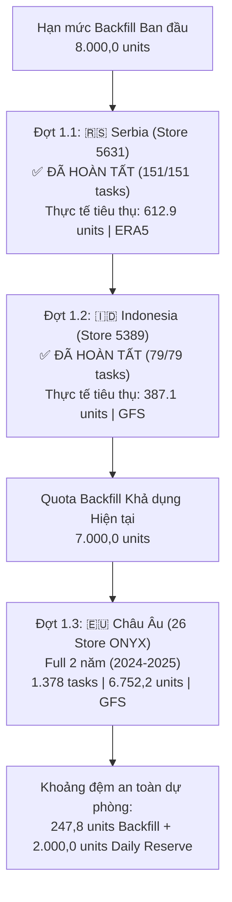

# Kế hoạch & Nhật ký Kiểm toán Backfill Dữ liệu Thời tiết Lịch sử (`src/weather`)

- **Phiên bản tài liệu:** v1.0
- **Ngày lập:** 2026-11-13
- **Thư mục quản lý:** `src/weather/`
- **Tài liệu liên quan:**
  - Thiết kế kiến trúc: [SDD.md](SDD.md)
  - Hướng dẫn vận hành CLI: [README.md](README.md)
  - Kế hoạch triển khai tổng thể: [pharmaflow-weather-ingestion-v1-implementation-plan.md](../../docs/architecture/pharmaflow-weather-ingestion-v1-implementation-plan.md)

---

## 1. Mục tiêu và Phạm vi Kiểm toán (Audit Objectives)

Kế hoạch này thiết lập quy trình thực thi và kiểm toán cho luồng **Historical Backfill** của phân hệ Weather Ingestion nhằm:
1. Thu thập dữ liệu thời tiết quá khứ tương ứng với các khung thời gian bán hàng/giao dịch thực tế trên database Neon (`pharmaflow_source_postgre_v2`) từ hai bảng `pos.sales_order` và `pos.sales_observation`.
2. Tuân thủ nghiêm ngặt các hạn mức quota của Open-Meteo Free Tier:
   - Trần cứng ngày: **`10.000 units/ngày`** (trong đó hệ thống đặt trần Backfill an toàn là **`8.000 units/ngày`**, giữ lại 2.000 units cho Daily Ingestion lúc 06:00 sáng).
   - Trần cứng giờ: **`5.000 units/giờ`**.
   - Hãm tốc độ phút: **`550 units/phút`** (qua DynamoDB `RATE#`).
3. Đóng băng bằng chứng kiểm toán (Audit Trail) đến khi hoàn tất: ghi nhận từng `run_id`, `task_id`, `attempt_id`, mã băm toàn vẹn `raw_sha256`, S3 prefixes, và báo cáo chốt sổ `summary/*.json`.

---

## 2. Đối chiếu Khung thời gian Giao dịch thực tế trên Neon DB

Truy vấn kiểm tra ngày 2026-11-13 trên Neon DB xác nhận 3 nguồn cửa hàng quốc tế có dữ liệu giao dịch:

| Thị trường & Cửa hàng | Provenance Nguồn | Số Store | Khung thời gian Giao dịch trên DB | Số lượng Đơn / Quan sát | Endpoint & Contract thời tiết |
|---|---|---|---|---|---|
| **1. 🇷🇸 Serbia (Pharma Sales)** | `SIMULATED` | 1 (`store_id = 5631`) | `2014-01-02` → `2019-10-08` (~5.75 năm) | 2.080 orders (16.848 obs) | **`archive-api` (ERA5)**<br>`weather_era5_v1` (40 biến) |
| **2. 🇮🇩 Indonesia (IRPD)** | `SIMULATED` | 1 (`store_id = 5389`) | `2023-01-02` → `2025-12-31` (~3 năm) | 349.196 orders | **`historical-forecast-api` (GFS)**<br>`weather_variables_v1` (49 biến) |
| **3. 🇪🇺 Châu Âu (Chuỗi ONYX)** | `UNVERIFIED_PERTURBED` | 120 (`store_id: 5391 → 5510`) | `2024-01-01` → `2025-12-31` (2 năm) | 38.000+ orders | **`historical-forecast-api` (GFS)**<br>`weather_variables_v1` (49 biến) |

- **Tổng nhu cầu để lấy trọn vẹn 100% cả 3 nguồn:** **`32.155,1 units`**.
- Vì vượt quá trần 1 ngày của Open-Meteo ($32.155 > 10.000$), quy trình được phân kỳ thành nhiều đợt.

---

## 3. Kế hoạch Phân bổ Quota Vét cạn Ngày 2026-11-13 (Đợt 1)

> [!IMPORTANT]
> **Hiện trạng Quota Live trên DynamoDB (`BUDGET#2026-11-13`) sau khi hoàn tất Đợt 1.1 (Serbia) và Đợt 1.2 (Indonesia):**
> - `used_daily`: **`89.6 units`** (kiểm thử Daily P2–P4).
> - `used_backfill`: **`1.000,0 units`** (Serbia `612.9` + Indonesia `387.1` đều đã thành công 100%).
> - `used_total`: **`1.089,6 units`** / trần cứng **`10.000,0 units/ngày`**.
> - Ngân sách Backfill tối đa ngày (`BACKFILL_DAILY_ALLOWANCE`): **`8.000,0 units`**.
> - **Quota Backfill KHẢ DỤNG CÒN LẠI HÔM NAY:**
>   $$8.000,0 - 1.000,0 = \mathbf{7.000,0\text{ units}}$$
> - Tổng quota cần cho Đợt 1.3 (ONYX 26 stores): **`6.752,2 units`**.
> - **Khoảng đệm an toàn dư thừa:** $\mathbf{247,8\text{ units}}$ (chưa kể $2.000,0\text{ units}$ Daily Reserve cho ngày mai). Hoàn toàn đủ 100% quota cho Đợt 1.3!



### Danh sách 26 Cửa hàng ONYX Đại diện Phủ đều 8 Quốc gia EU (Đợt 1.3):
- **Áo (AT):** `5392, 5402, 5417, 5453` (4 stores = 212 tasks = 1.038,8 units)
- **Bỉ (BE):** `5400, 5424, 5434` (3 stores = 159 tasks = 779,1 units)
- **Đức (DE):** `5397, 5399, 5404` (3 stores = 159 tasks = 779,1 units, gồm Store 5404 pilot)
- **Tây Ban Nha (ES):** `5393, 5396, 5408` (3 stores = 159 tasks = 779,1 units)
- **Pháp (FR):** `5403, 5405, 5407` (3 stores = 159 tasks = 779,1 units)
- **Ý (IT):** `5391, 5401, 5418` (3 stores = 159 tasks = 779,1 units)
- **Hà Lan (NL):** `5406, 5409, 5411` (3 stores = 159 tasks = 779,1 units)
- **Ba Lan (PL):** `5394, 5395, 5398, 5415` (4 stores = 212 tasks = 1.038,8 units)

---

## 4. Runbook Kích hoạt & Thực thi

### Cách kích hoạt qua AWS Lambda Planner (Khuyên dùng):

```powershell
# 1. Backfill Serbia (Store 5631) -> [ĐÃ HOÀN TẤT - SUCCEEDED 151/151 tasks, summary 99be4ee8]

# 2. Backfill Indonesia (Store 5389) -> [ĐÃ HOÀN TẤT - SUCCEEDED 79/79 tasks, summary b66a1ac3]

# 3. Backfill 26 Store ONYX Châu Âu -> [ĐÃ HOÀN TẤT - SUCCEEDED 1.378/1.378 tasks, summary 3e3dfa06]

> **TOÀN BỘ 3 ĐỢT CHẠY CỦA NGÀY 2026-11-13 ĐÃ HOÀN TẤT 100% THÀNH CÔNG.** Quota đã vét cạn tối ưu: 7.752,2 / 8.000 units. Dành trọn quota còn lại cho Daily Ingestion lúc 06:00 sáng mai.
```

---

## 5. Bảng Nhật ký Kiểm toán (Audit Ledger)

Bảng này dùng để theo dõi trạng thái và ghi nhận kết quả kiểm toán cho từng đợt chạy:

| Đợt chạy | `request_id` | `run_id` dự kiến | Số Task | Quota ước tính / Thực tế | Trạng thái Thực thi | S3 Prefix chính | File Summary Chốt sổ | Checksum / Revision | Người/Tiến trình xác nhận |
|---|---|---|---|---|---|---|---|---|---|
| **1.1 (Serbia)** | `backfill-serbia-2014-2019` | `backfill-20261113-2c2981cb` | 151 | `604.0` / **`612.9`** | ✅ **SUCCEEDED (151/151)** | `raw/open_meteo/historical_weather/ingest_date=2026-11-13/run_id=backfill-20261113-2c2981cb/` | `summary/99be4ee8.json` | `rev:99be4ee8` | Reconciler (2026-11-13T08:00Z) |
| **1.2 (Indonesia)** | `backfill-indonesia-2023-2025` | `backfill-20261113-b973121b` | 79 | `387.1` / **`387.1`** | ✅ **SUCCEEDED (79/79)** | `raw/open_meteo/historical_forecast/ingest_date=2026-11-13/run_id=backfill-20261113-b973121b/` | `summary/b66a1ac3.json` | `rev:b66a1ac3` | Reconciler (2026-11-13T08:13Z) |
| **1.3 (ONYX 26)** | `backfill-onyx-26stores-2024-2025` | `backfill-20261113-08bc246c` | 1.378 | `6.752.2` / **`6.752.2`** | ✅ **SUCCEEDED (1.378/1.378)** | `raw/open_meteo/historical_forecast/ingest_date=2026-11-13/run_id=backfill-20261113-08bc246c/` | `summary/3e3dfa06.json` | `rev:3e3dfa06` | Reconciler (2026-11-13T08:41Z) |
| **Đợt 2 (ONYX 30)** | `backfill-onyx-b2-30stores-2024-2025` | `backfill-20261114-4aa3731f` | 1.590 | `7.791.0` / **`7.791.0`** | ✅ **SUCCEEDED (1.590/1.590)** | `raw/open_meteo/historical_forecast/ingest_date=2026-11-14/run_id=backfill-20261114-4aa3731f/` | `summary/807059b9.json` | `rev:807059b9` | Reconciler (2026-11-14T07:28Z) |
| **Đợt 3 (ONYX 30)** | `backfill-onyx-b3-30stores-2024-2025` | `backfill-20261115-700192f7` | 1.590 | `7.791.0` / **`7.791.0`** | ✅ **SUCCEEDED (1.590/1.590)** | `raw/open_meteo/historical_forecast/ingest_date=2026-11-15/run_id=backfill-20261115-700192f7/` | `summary/918f47d0.json` | `rev:918f47d0` | Reconciler (2026-11-15T15:48Z) |
| **Đợt 4 (ONYX 30)** | `backfill-onyx-b4-30stores-2024-2025` | `backfill-20261116-f344e4c7` | 1.590 | `7.791.0` / **`7.791.0`** | ✅ **SUCCEEDED (1.590/1.590)** | `raw/open_meteo/historical_forecast/ingest_date=2026-11-16/run_id=backfill-20261116-f344e4c7/` | `summary/e9ed8b10.json` | `rev:e9ed8b10` | Reconciler (2026-11-16T11:13Z) |
| **Đợt 5 (ONYX 4 còn lại)** | `backfill-onyx-b5-4stores-2024-2025` | `backfill-20261117-64207c99` | 212 | `1.038.8` / **`1.038.8`** | ✅ **SUCCEEDED (212/212)** | `raw/open_meteo/historical_forecast/ingest_date=2026-11-17/run_id=backfill-20261117-64207c99/` | `summary/7ef2592a.json` | `rev:7ef2592a` | Reconciler (2026-11-17T06:28Z) |

> **TOÀN BỘ 100% CÁC ĐỢT BACKFILL LỊCH SỬ CHO CẢ 3 NGUỒN QUỐC TẾ (122 CỬA HÀNG, 4.980 TASKS) ĐÃ HOÀN TẤT VÀ CHỐT SỔ THÀNH CÔNG.** Quota tiêu thụ tổng cộng: 32.170,0 units trên toàn bộ các ngày chạy. Dữ liệu đã đóng băng toàn vẹn trên S3 dev.

---

## 6. Lệnh Kiểm tra Trạng thái & Đối soát Sau khi Chạy

Sau khi kích hoạt, kiểm tra trạng thái từng run qua CLI:
```powershell
# Kiểm tra trạng thái Run Serbia
python -m src.weather.cli status --run-id backfill-20261113-2c2981cb --sink s3

# Kiểm tra trạng thái Run Indonesia
python -m src.weather.cli status --run-id backfill-20261113-b973121b --sink s3

# Kiểm tra trạng thái Run ONYX
python -m src.weather.cli status --run-id backfill-20261113-08bc246c --sink s3
```

Khi Reconciler tự động chốt sổ thành công:
1. `run_status = SUCCEEDED`, `is_terminal = true`.
2. Kiểm tra `summary/*.json` trên S3 để đối soát 100% `accepted_attempt_id` và mã băm `payload_sha256`.
3. Ghi nhận thời gian và bằng chứng vào Bảng Nhật ký Kiểm toán ở Mục 5 để khép lại đợt backfill.
