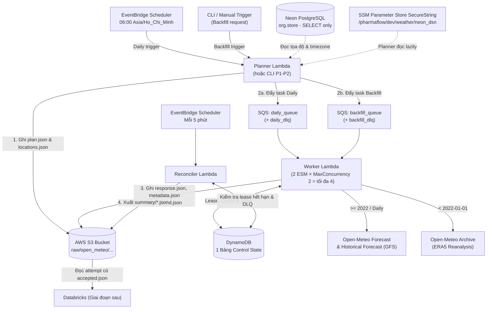

# Software Design Document (SDD): PharmaFlow Weather Ingestion (`src/weather`)

- **Phiên bản thiết kế:** v1.3 (cập nhật hoàn tất Backfill lịch sử & triển khai code/test P5 `full_network` `0.111° floor` + `HOUR#` limiter)
- **Ngày lập:** 2026-11-11 · **Cập nhật lần cuối:** 2026-11-17 (chốt cấu hình P5 `880` điểm = `4.928` units/ngày @ `06:00 VN`)
- **Thư mục triển khai:** `src/weather/`
- **Tài liệu liên quan:**
  - Kế hoạch triển khai: [pharmaflow-weather-ingestion-v1-implementation-plan.md](../../docs/architecture/pharmaflow-weather-ingestion-v1-implementation-plan.md)
  - Bằng chứng P0 Probe: [jobs/W09.11/weather-openmeteo/README.md](../../jobs/W09.11/weather-openmeteo/README.md)
  - Hạ tầng S3 Dev (Terraform): [src/infra/terrafrom/README.md](../infra/terrafrom/README.md)
  - Schema nguồn PostgreSQL: [schema_full.sql](../synthetic_data_source/pharmaflow_source_postgre/schema_full.sql)

---

## 1. Mục tiêu và Phạm vi hệ thống

### 1.1. Bài toán cần giải quyết
Phân hệ **Weather Ingestion (`src/weather`)** chịu trách nhiệm thu thập dữ liệu thời tiết cho danh sách cửa hàng nhà thuốc trong hệ thống PharmaFlow từ **Open-Meteo** và lưu trữ nguyên bản (**Raw Layer**) lên **AWS S3**. Dữ liệu Raw này là đầu vào bất biến để **Databricks** xử lý sang tầng Silver/Gold, phục vụ các mô hình dự báo nhu cầu bán hàng (`DATA -> FORECAST -> RISK -> DECISION -> OPERATIONAL OUTCOME`).

Hệ thống hỗ trợ 2 luồng thu thập chính:
1. **Daily Forecast (Dự báo hàng ngày):** Tự động chạy lúc `06:00` sáng theo giờ Việt Nam (`Asia/Ho_Chi_Minh`), lấy dự báo **16 ngày tới** (hôm nay + 15 ngày tiếp theo) ở độ mịn từng giờ (`hourly`) kèm một số chỉ số ngày đặc thù (`daily`).
2. **Historical Backfill (Truy xuất lịch sử theo yêu cầu):** Lấy dữ liệu quá khứ cho một tập cửa hàng trong khoảng thời gian `[start_date, end_date]` tùy chọn, tự động định tuyến endpoint phù hợp theo mốc thời gian trước hay từ năm `2022` trở đi.

### 1.2. Phạm vi & Ranh giới trách nhiệm
- **Thuộc phạm vi `src/weather`:** Đọc danh sách cửa hàng từ Neon PostgreSQL (chỉ đọc), lập kế hoạch và chia nhỏ tác vụ, kiểm soát quota API, gọi Open-Meteo, kiểm tra chất lượng cơ bản, lưu JSON gốc + metadata + marker xác nhận lên S3, theo dõi trạng thái và phục hồi lỗi.
- **Nằm ngoài phạm vi:** Tầng biến đổi dữ liệu Silver/Gold trên Databricks, mô hình dự báo bán hàng, giao diện web và database ứng dụng của web.

### 1.3. Trạng thái hiện tại
| Hạng mục | Trạng thái | Ghi chú |
|---|---|---|
| **P0a — Thử nghiệm Open-Meteo API** | Hoàn tất (`2026-11-10`) | Đã chạy 3 đợt probe thực tế (45+ requests) kiểm chứng model, biến, DST, giới hạn archive và rate limit headers. |
| **Hạ tầng S3 Dev (Terraform)** | Đã apply (`2026-11-11`) | Khai báo tại `src/infra/terrafrom/environments/dev/main.tf`. Account `522346104596`, `ap-southeast-1`: bucket state, bucket dữ liệu `pharmaflow-dev-weather-raw-...` và 2 IAM policy (writer/reader) đã tồn tại thật. Ngày 2026-11-11 đã apply thêm prefix `historical_weather/` (ERA5) vào 2 policy: plan `0 add / 2 change / 0 destroy`, plan chạy lại không còn khác biệt, đọc lại policy writer từ IAM thấy đủ 3 prefix. `terraform test` offline (mock provider) pass 3/3. Ngày 2026-11-13 (P2) đã apply thêm role `pharmaflow-dev-weather-local-writer` gắn policy writer (plan `2 add / 0 change / 0 destroy`, chạy lại plan không còn khác biệt, `terraform test` pass 5/5). Policy reader vẫn chưa gắn cho role nào. Bucket đã có object Weather đầu tiên, ghi từ smoke P2. Từ P3 (2026-11-13), policy writer còn được gắn cho 3 role Lambda (`pharmaflow-dev-weather-{planner,worker,reconciler}-lambda`). |
| **P0b — Kiểm tra Neon live (`org.store`)** | Hoàn tất (`2026-11-11`); `cohorts.yaml` đã tạo ở P1 | Đã truy vấn `SELECT-only` trên DB `pharmaflow_source_postgre_v2` (không phải `neondb`, DB này đã xoá): 2.816 store, tất cả `ACTIVE`, tọa độ và `timezone_name` hợp lệ (`LONGCHAU` 2.694, `ONYX` 120 `UNVERIFIED`, 2 điểm `SIMULATED`). Cohort pilot đã duyệt (7 store): `516`, `104`, `2137`, `1234` (Long Châu), `5404` (Berlin, kiểm tra DST), `5389` và `5631` (mô phỏng). Role `weather_reader` chỉ `SELECT` 8 cột của `org.store`, đã kiểm tra bằng `has_column_privilege` và đăng nhập thật; DSN đặt ở biến `WEATHER_NEON_DSN`. Đã xoá role thừa `planner_lambda_readonly`, xoay mật khẩu `neondb_owner` và dọn sạch `.env`. |
| **P1 — Mã nguồn `src/weather/` (Local CLI)** | Hoàn tất, có code chạy được và đã smoke live trên máy local (`2026-11-12` giờ VN) | 11 module (`config`, `locations`, `limiter`, `open_meteo`, `storage`, `planner`, `validation`, `worker`, `state`, `reconcile`, `cli`) cùng [README.md](README.md). Test offline: `pytest tests/weather` đạt **84/84** (56 test gốc theo `TEST_CASES.md` + 28 test phụ). Smoke live ghi vào `.runtime/weather/`: run daily `daily-20261112-43a4ad4d` (store 516, 5404) và run backfill `backfill-20261112-40918cf6` (store 516, `2021-12-25..2022-01-05`, cắt thành 1 task ERA5 + 1 task GFS). Cả hai run đều `SUCCEEDED`, `resume` gọi 0 HTTP, SHA-256 của `response.json` khớp `accepted.json` và `metadata.json`. Xem mục 7.1. |
| **P2 — Ghi S3 Dev từ CLI local** | Hoàn tất (`2026-11-13` giờ VN) | Terraform tạo role `pharmaflow-dev-weather-local-writer`: chỉ `admin-nhut` được assume, phiên tối đa 1 giờ, chỉ gắn policy writer. `simulate-principal-policy` cho 15/15 kết quả đúng kỳ vọng (Get/Put trong 3 prefix được phép; `DeleteObject`, `DeleteObjectVersion` và ghi ngoài prefix bị từ chối). `--sink s3` ghi thật lên bucket dev qua role này: run daily `daily-20261113-7ab85399` và run backfill `backfill-20261113-c992aa84` đều `SUCCEEDED`, có 18 object. `resume` gọi 0 HTTP và không tạo object mới; đọc ngược từ S3 thì SHA-256 khớp ở 4/4 task. Test offline 99/99. Xem mục 7.2. |
| **P3 — AWS Compute & Queue (Lambda/SQS/DynamoDB)** | Hoàn tất (`2026-11-13` giờ VN), nghiệm thu bằng **kích hoạt thủ công**; trong P3 lịch còn `DISABLED`, từ P4 đã `ENABLED` | Terraform `weather_compute.tf` tạo 37 resource (apply `37 added / 0 changed / 0 destroyed`, chạy lại plan không còn khác biệt; `terraform test` 8/8). Code deploy bằng `scripts/weather/deploy_code.ps1` (`CodeSha256` khớp gói local). DSN Neon nằm ở SSM SecureString, không có trong Terraform state. Smoke live đạt 5/5 kịch bản: daily `daily-20261113-52f2a1fe`, backfill `backfill-20261113-543ad296`, SQS giao trùng (0 HTTP), message độc vào DLQ sau 5 lần nhận và alarm chuyển `ALARM`, replay Planner (không đọc SSM/Neon, không sinh task). Test offline 125/125. Xem mục 7.3. |
| **P4 — Lịch tự động** | **Hoàn tất** (`2026-11-16` giờ VN) | Lịch EventBridge tự động `06:00` VN đã nghiệm thu thành công với 2 snapshot tự động liên tiếp thật: `daily-20261115-fdcf088e` (chốt 06:03 VN ngày 15/11) và `daily-20261116-514a8024` (chốt 06:03 VN ngày 16/11). 100% store đủ 16 ngày, chốt trước 09:00. Gate P4 chính thức đóng. Xem mục 7.4. |
| **P5 — Mở rộng toàn mạng lưới** | **Đã deploy lên AWS Dev (`2026-11-17`)**, chờ chạy lịch thật 06:00 VN đầu tiên & nối Databricks | Đã deploy gói Lambda (`24.333.041 bytes`) + `terraform apply` (`planner.timeout=180s`, `planner-daily` chuyển sang `full_network` @ `06:00 VN`). Smoke live 3/3 đạt (`14` modules), live Planner `plan_dry_run` trên Neon trả đúng **880 tasks / 4.928,0 units**. Xem mục 3.6 & 7.4. |

---

## 2. Kiến trúc tổng thể

Hệ thống được thiết kế theo mô hình **tách rời phần lập kế hoạch (Planner) và phần thực thi (Worker)** thông qua hàng đợi, giúp kiểm soát chặt chẽ tốc độ gọi API miễn phí của Open-Meteo và đảm bảo chạy lại không trùng lặp.



### Danh mục dịch vụ AWS sử dụng (đã triển khai ở P3)
> **Lưu ý lộ trình:** Ở giai đoạn **P1–P2**, toàn bộ quy trình chạy qua **Python CLI trên máy local**: P1 ghi vào `LocalSink` (`.runtime/weather/`), P2 ghi thẳng lên **S3 Dev** (`--sink s3`). Control state ở P1–P2 là file JSON local (`state.py`), CLI thực thi trực tiếp task trong `plan.json` thay cho SQS. Các dịch vụ bên dưới được dựng ở **P3** (`src/infra/terrafrom/environments/dev/weather_compute.tf`), và hai lịch EventBridge được bật từ **P4**. CLI local vẫn dùng được song song.

| Dịch vụ AWS | Số lượng | Vai trò trong hệ thống | Chi phí ước tính (Dev / Pilot) |
|---|---|---|---|
| **Amazon S3** | 1 bucket dữ liệu (+1 bucket `tfstate`) | Lưu bất biến `plan.json`, `locations.json`, `response.json`, `metadata.json`, `accepted.json`, `summary/*.json`. | Vài trăm VNĐ/tháng (vài trăm MB). |
| **AWS IAM** | 5 role + 2 policy S3 | 3 role Lambda, 1 role Scheduler, 1 role local writer cho CLI máy dev (`pharmaflow-dev-weather-local-writer`); 2 policy S3 là writer và reader (reader chưa gắn). Chỉ Planner đọc được DSN; không role nào có `s3:DeleteObject`. | **$0.00** (miễn phí). |
| **AWS Lambda** | 3 function (`planner`, `worker`, `reconciler`) | Dùng chung 1 codebase `src/weather/` (entrypoint `src.weather.handlers.*`); tách 3 function để tách trigger và quyền IAM. `python3.12`, `x86_64`, 256 MB; timeout 120 / 150 / 60 giây. | **$0.00** (Always Free: 1M calls & 400.000 GB-s/tháng). |
| **Amazon SQS** | 5 queue (`daily`, `daily-dlq`, `backfill`, `backfill-dlq`, `scheduler-dlq`) | Đệm tác vụ, tách backlog Backfill khỏi Daily, tự retry và gom lỗi dứt điểm vào DLQ (`maxReceiveCount = 5`). | **$0.00** (Always Free: 1M requests/tháng). |
| **EventBridge Scheduler** | 2 lịch chạy | Kích Planner lúc `06:00` `Asia/Ho_Chi_Minh` hằng ngày và kích Reconciler mỗi `5 phút`. Bật từ P4. | **$0.00** (Free Tier: 14M invocations/tháng). |
| **Amazon DynamoDB** | 1 bảng `pharmaflow-dev-weather-control` (`PAY_PER_REQUEST`) | Lease chống chạy trùng, quota ngày và quota phút của Open-Meteo, trạng thái run/task (xem mục 4.3). | **$0.00** hoặc vài xu/tháng. |
| **SSM Parameter Store** *(đã chọn thay cho Secrets Manager)* | 1 parameter SecureString `/pharmaflow/dev/weather/neon_dsn` (`alias/aws/ssm`) | Lưu DSN Neon `SELECT-only` cho Planner. Ghi bằng `scripts/weather/put_neon_dsn_param.ps1`; Terraform không quản lý nên giá trị không vào state. | **$0.00**. |
| **CloudWatch** | 3 log group (30 ngày) + 6 alarm | 3 alarm "DLQ có message" và 3 alarm `Errors > 0`, chưa gắn action thông báo. **Chưa có** alarm cho trường hợp Daily chưa xong trước 09:00; task quá hạn chỉ được Reconciler đánh `EXPIRED` (việc còn mở, xem mục 7.4). | **$0.00** (nằm trong Free Tier). |

---

## 3. Các quyết định thiết kế đã chốt (từ kết quả thực nghiệm)

Trong quá trình thăm dò thực tế ngày `2026-11-10` tại [jobs/W09.11/weather-openmeteo](../../jobs/W09.11/weather-openmeteo/README.md), nhóm đã phát hiện 6 đặc tính quan trọng của Open-Meteo và chốt thiết kế tương ứng:

1. **Cả 3 endpoint đều dùng được trên gói Free phi thương mại (CC BY 4.0):**
   - `api.open-meteo.com/v1/forecast` (Daily Forecast)
   - `historical-forecast-api.open-meteo.com/v1/forecast` (Historical Forecast — trước đây từng nhầm là chỉ có ở gói trả phí)
   - `archive-api.open-meteo.com/v1/archive` (Historical Weather ERA5)
   - Giao thức HTTPS (`TLSv1.3`), nén `Content-Encoding: deflate`, không dùng API key, quản lý hạn mức theo **địa chỉ IP nguồn** và **trọng số (`X-RateLimit-Cost`)**. Cần ghi nguồn `"Weather data by Open-Meteo.com (CC BY 4.0)"` trên các sản phẩm hiển thị/báo cáo đồ án.

2. **Chốt model `models=gfs_global` cho Forecast & Historical Forecast:**
   - Phủ đủ **16 ngày = 384 giờ liên tục với `0 null`** ở cả Việt Nam và châu Âu (kể cả ngày 15–16).
   - Trùng khớp 100% với `gfs_seamless` trên cả 2 endpoint. Không dùng `best_match` vì cơ chế tự ghép nhiều model khiến dữ liệu thiếu nhất quán theo vùng.
   - *(Ghi chú khí tượng: 5 ngày đầu GFS có bước gốc 1 giờ; từ ngày 6 đến ngày 16 bước gốc là 3 giờ được Open-Meteo nội suy đều thành 1 giờ).*
   - **Cập nhật từ các lần chạy live P1–P4:** khác với probe P0, **các giờ cuối của ngày 16** đôi khi trả `null` ở **mọi biến**. Ví dụ: P1 store 516 có 10 giờ (`2026-11-27` 14:00–23:00 VN); P2 store 5404 có 4 giờ; P4 ngày 1 store 5404 và 5631 bị `ACCEPTED_WITH_WARNINGS`. Hiện tượng này không cố định theo store. Validation vẫn chấp nhận các snapshot này vì các biến cốt lõi không null 100%. Tầng Silver phải coi `null` là thiếu dữ liệu (không phải 0) và đọc `null_report` trong `metadata.json`.

3. **Phân luồng Historical theo mốc `2022-01-01`:**
   - Kho lưu trữ của `gfs_global` trên `historical-forecast-api` chỉ bắt đầu từ **`2021-03-23`** (`17/24` giờ; từ `2021-03-22` trở về trước trả toàn `null`).
   - Do đó hệ thống chốt mốc ranh giới sạch tại **`2022-01-01`**:
     - **Từ `2022-01-01` trở đi:** Gọi `historical-forecast-api` (`models=gfs_global`, `source_type = HISTORICAL_FORECAST_STITCHED`).
     - **Trước `2022-01-01` (`1940-01-01` → `2021-12-31`):** Tự động chuyển sang `archive-api` (ERA5 reanalysis, `source_type = HISTORICAL_ERA5_REANALYSIS`) để hỗ trợ được cả các tập dữ liệu bán hàng lịch sử như Pharma Sales `2015–2019`.
   - Nếu một lệnh backfill cắt ngang `2022-01-01`, **Planner tự động tách đôi** tại ranh giới `2021-12-31 | 2022-01-01`, không bao giờ trộn 2 nguồn trong cùng một task.

4. **Giải quyết bẫy lệch giờ DST bằng `timeformat=unixtime`:**
   - Khi test trên `Europe/Berlin` qua ngày đổi giờ mùa đông `2026-10-25` với `timeformat=iso8601`, Open-Meteo dùng **một `utc_offset_seconds` cố định (`3600` = `GMT+1`)** cho toàn bộ phản hồi, khiến các chuỗi giờ trước ngày đổi giờ bị **lệch 1 tiếng** so với giờ địa phương thực tế (`+02:00`).
   - **Quyết định:** Bắt buộc gửi **`timeformat=unixtime`** kèm `timezone=<location.timezone_name>`. Tầng Silver dùng `ZoneInfo(location.timezone_name)` để quy đổi epoch UTC sang giờ địa phương (tự động xử lý chuẩn các ngày 23 giờ hoặc 25 giờ khi đổi DST; với vùng có DST, tầng Silver tự tổng hợp thống kê ngày từ `hourly`).

5. **Phòng chống bẫy `HTTP 200` trả toàn `null`:**
   - Khi gọi ngày ngoài phạm vi dữ liệu (ví dụ năm `2016` trên `historical-forecast-api`) hoặc biến không được hỗ trợ, Open-Meteo **không trả lỗi `4xx`** mà vẫn trả **`HTTP 200`** với mảng toàn `null`.
   - **Quyết định:** Không dựa vào `HTTP 200` để kết luận thành công; `validation.py` bắt buộc kiểm tra tỷ lệ `null` của các biến cốt lõi trước khi cấp marker `accepted.json`.

6. **Nguyên tắc độ mịn tầng Raw & Chính sách Gom cụm Lưới (Grid Clustering — Tối ưu dưới 15 phút) cho Toàn mạng lưới:**
   - Ở giai đoạn thử nghiệm (Pilot 7 cửa hàng), hệ thống áp dụng độ mịn `1 cửa hàng = 1 HTTP request`.
   - Toàn bộ mạng lưới hiện có **2.816 cửa hàng** (2.694 Long Châu tại VN và 122 cửa hàng quốc tế). Nếu gọi 1:1 từng cửa hàng thì tổng quota là $2.816 \times 5.6 = 15.769,6\text{ units/ngày}$, vượt quá hạn mức miễn phí 10.000 units/ngày của Open-Meteo. Đồng thời, Open-Meteo giới hạn **5.000 units/giờ** trên gói Free.
   - **Quyết định chốt chính sách Gom cụm Lưới (Grid Clustering) cho P5, tối ưu sát trần 5.000 units/giờ ở lịch `06:00 VN`:**
     - **122 cửa hàng quốc tế** (8 nước châu Âu, Indonesia, Serbia): giữ nguyên tọa độ theo đúng dữ liệu nguồn và không gom cụm. Trong đó 120 store Onyx có tọa độ `UNVERIFIED_PERTURBED` và 2 store là `SIMULATED`, nên đây **không** phải tọa độ nhà thuốc vật lý đã xác minh. Chi phí: $122 \times 5.6 = 683,2\text{ units/ngày}$.
     - **2.694 cửa hàng Việt Nam (Long Châu):** gom cụm theo lưới không gian độ phân giải **$0.111^\circ$** (cạnh ô khoảng 12,3 km) với phép chia **`floor`** (`row = floor(lat / 0.111), col = floor(lon / 0.111)`), gốc lưới tại `(0, 0)`, tọa độ đại diện là trọng tâm (`centroid`) các cửa hàng trong ô. Kiểm tra trực tiếp trên Neon `org.store` (ngày 2026-11-17) thu được **758 ô** VN.
       - *(So sánh với cấu hình nháp `0.13° round` cũ = 655 ô = 4.351,2 units: việc tinh chỉnh xuống `0.111° floor` tận dụng sát trần 5.000 units/giờ để tăng thêm 103 trạm đại diện cho VN mà vẫn giữ 72 units đệm dưới ngưỡng 5.000/h; `0.110° round` ra 773 ô = 5.012 units bị vượt trần).*
     - **Tổng số điểm gọi API hằng ngày:** $758 + 122 = \mathbf{880\text{ điểm trạm}}$.
     - **Tổng quota tiêu thụ:** $880 \times 5.6 = \mathbf{4.928,0\text{ units/ngày}}$ (sát trần `4.9xx / 5.000 units/giờ`, chiếm 49,3% hạn mức ngày 10.000, vẫn chừa 5.072 units cho các nhu cầu khác trong ngày). Theo tháng: $4.928 \times 30 = 147.840$ unit, dưới mức 300.000.
     - **Lịch chạy cố định `06:00 VN` (`23:00 UTC`):** Kiểm tra múi giờ xác nhận `06:00 VN` là mốc sớm nhất đồng bộ cùng ngày `D` cho **cả VN lẫn toàn bộ 9 múi giờ Châu Âu suốt 365 ngày/năm** (mùa đông CET `UTC+1` là `00:00` ngày `D`, mùa hè CEST `UTC+2` là `01:00` ngày `D`; nếu chạy `05:00 VN` thì mùa đông EU tụt về `23:00` ngày `D-1` và bị nhảy ngày 2 lần/năm khi đổi giờ DST).
     - **Thông lượng và thời gian (ước tính, chưa đo live 880 điểm):** limiter phút `RATE#` có trần 550 unit/phút (~98 call/phút), cộng limiter giờ `HOUR#` trần an toàn **4.980 units/giờ**. Với nhịp ~90–95 call/phút, 880 điểm mất **khoảng 9–11 phút**; Reconciler 5 phút dự kiến chốt summary khoảng 06:15–06:20 VN.
     - **Đánh đổi kỹ thuật đã biết:** probe P0 cho thấy hai điểm cách nhau `630 m` ở TP.HCM, dù cùng một ô lưới GFS (`10.71917, 106.640625`), vẫn lệch nhiệt độ `0,1°C` (`25,9°C` so với `26,0°C`) do Open-Meteo hiệu chỉnh theo độ cao (`20,0 m` so với `9,0 m`). Gom cụm `0.111°` chấp nhận bỏ phần vi khí hậu cùng ô để tối ưu quota và tốc độ dưới 15 phút.
     - **Trạng thái triển khai (2026-11-17):** Đã triển khai đầy đủ trong code, pass 142/142 unit tests + 8/8 Terraform tests, **đã deploy lên AWS Dev** (`deploy_code.ps1` khớp `CodeSha256`, `terraform apply` xong `0 add / 2 change / 0 destroy`), smoke live 3/3 đạt và live Planner `plan_dry_run` trên Neon trả đúng `880` tasks / `4.928,0` units. Còn chờ đo thông lượng live 880 điểm lúc 06:00 VN ngày kế tiếp và nối Databricks (Silver/Gold) qua `store_grid_mapping.json`.

---

## 4. Thiết kế chi tiết các thành phần

### 4.1. Location Reader & Cohort Policy (`locations.py`)
Planner đọc danh sách cửa hàng từ bảng `org.store` trên Neon bằng tài khoản chỉ có quyền `SELECT` (thông qua secret `WEATHER_NEON_DSN`), tuyệt đối không dùng tài khoản hay helper ghi của source loader.

```sql
SELECT store_id, store_code, country_code, latitude, longitude,
       timezone_name, store_status, source
FROM org.store
WHERE store_id = ANY(%s)
ORDER BY store_id;
```

Mỗi bản ghi được kiểm tra và phân loại thành `eligible_locations` hoặc `rejected_locations`:
1. **Tọa độ (`latitude`, `longitude`):** Phải khác `NULL`, là số hữu hạn trong khoảng `[-90, 90]` và `[-180, 180]`. Không tự điền `0` cho `NULL`, không tự geocode địa chỉ.
2. **Múi giờ (`timezone_name`):** Phải hợp lệ khi khởi tạo `ZoneInfo(timezone_name)`.
3. **Trạng thái (`store_status`) & Nguồn (`source`):** **Hễ `store_status = 'ACTIVE'` và đạt đủ mục 1–2 thì đều nhận vào `eligible_locations`**, không chặn theo `source` (bao gồm cả Long Châu, Onyx `UNVERIFIED`, hay IRPD/Pharma Sales `SIMULATED` nếu nằm trong danh sách IDs/cohort yêu cầu). Chỉ loại vào `rejected_locations` khi không thấy `store_id`, sai/thiếu `lat/lon`, sai `timezone_name`, `store_status = 'INACTIVE'`, hoặc `store_status = 'UNKNOWN'` (trừ khi `cohorts.yaml` bật override có lý do rõ ràng).
4. **Truy vết nguồn (`source` & provenance):** Giữ nguyên cột `source`, đồng thời bắt buộc gắn thêm `coordinate_provenance`, `coordinate_verification_status` và `eligibility_reason` vào `locations.json` (và truyền tiếp sang `metadata.json`) để không bao giờ lẫn tọa độ công khai với tọa độ bị nhiễu hoặc tọa độ mô phỏng đại diện vùng.

*(Lưu ý: `org.warehouse` không có tọa độ riêng; phiên bản v1 thu thập thời tiết theo tọa độ `org.store`).*

---

### 4.2. Planner (`planner.py`)

Planner là một module Python thuần logic (không gọi Open-Meteo, không phụ thuộc SQS/Lambda bên trong lõi), chạy qua 5 bước:

1. **Xác thực yêu cầu:**
   - Mode `daily_forecast`: nhận `scheduled_at_utc` (bỏ trống thì lấy thời điểm hiện tại), `schedule_id`, `cohort_id`, tùy chọn `location_ids` và `refresh_seq`. Contract được cố định là `weather_variables_v1` và model `gfs_global`; caller không đổi được endpoint hay model.
     - **Thực tế triển khai:** Planner **không** chặn `scheduled_at_utc` ở quá khứ hoặc tương lai. Lần giả lập ở P4 (mục 7.4) đã truyền một thời điểm tương lai và vẫn qua được bước này.
     - Lớp chặn hiện có nằm ở Worker: `WINDOW_MISMATCH` (mục 4.4) từ chối snapshot có ngày dữ liệu lệch với cửa sổ plan.
     - Việc thêm kiểm tra độ lệch thời điểm ngay tại Planner vẫn còn mở (mục 7.4).
   - Mode `historical_backfill`: Nhận `request_id`, `start_date`, `end_date` (ISO inclusive), `location_ids` (hoặc `cohort_id`), `reason`. Kiểm tra `start_date <= end_date`, `end_date < today_vn` (khoảng tương lai không thuộc backfill) và `end_date >= 1940-01-01` (nếu toàn bộ khoảng `< 1940-01-01` thì trả lỗi `UNAVAILABLE_BEFORE_MODEL_COVERAGE`).

2. **Sinh `run_id` bất biến & cơ chế Replay chống lệch DB:**
   - `daily_forecast`: `daily-<YYYYMMDD_VN>-<hash8(schedule_date_vn | schedule_id | cohort_id | cohort_policy_ver | contract_ver | model [| refresh_seq])>`.
     - Khi truyền `location_ids`, `cohort_id` trở thành `pilot:ids=...`, nên `run_id` khác với run của cả cohort.
     - Khi truyền `refresh_seq`, giá trị này được đưa vào chuỗi băm để tạo một run làm mới có chủ đích. Trường `parent_run_id` **chưa được triển khai**.
   - `historical_backfill`: `backfill-<YYYYMMDD_VN>-<hash8(request_id | cohort_policy_ver | contract_ver)>`.
   - **Replay khi sự cố:** trước khi truy vấn Neon, Planner tính `predict_plan_key` rồi kiểm tra `plan.json` của `run_id` này đã tồn tại trên S3 hoặc local chưa.
     - Nếu đã tồn tại, Planner **không query lại Neon và không đọc SSM** (DSN chỉ được đọc lazily khi thật sự cần truy vấn `org.store`). Nó đọc đúng `plan.json` đã đóng băng và chỉ gửi lại các task chưa có `accepted.json`.
     - Kiểm chứng live ở P3: replay trả `neon_read: false`, và CloudTrail không ghi `GetParameter` nào cho lần replay.

3. **Đọc `org.store` & đóng băng `locations.json`:**
   - Nếu kết nối Neon thất bại, Planner báo lỗi fail ngay (tuyệt đối không tạo run rỗng rồi đánh dấu thành công).

4. **Chia Task, Định tuyến endpoint & Tính Budget:**
   - **Daily Forecast:** Mỗi store = 1 task. `valid_start_date` tính theo múi giờ riêng của store (`ZoneInfo(loc.timezone_name)`) tại `planned_at_utc`, `valid_end_date = valid_start_date + 15 days` (`forecast_days=16`). Endpoint `forecast`, contract `weather_variables_v1`, cost **`5.60`** units/task.
   - **Historical Backfill:**
     - Nếu khoảng ngày vắt qua `2022-01-01`, cắt thành 2 đoạn: `[max(start, 1940-01-01), min(end, 2021-12-31)]` (đi qua `archive-api` ERA5, `40` biến, **`4.00`** units/chunk) và `[max(start, 2022-01-01), end]` (đi qua `historical-forecast-api` GFS, `49` biến, **`4.90`** units/chunk).
     - Mỗi đoạn cắt thành các chunk liên tiếp tối đa **14 ngày/task** (`[d, min(d + 13 days, segment_end)]`).
   - **Sinh `task_id` duy nhất:** `sha256(run_id | store_id | endpoint_key | start_date | end_date | contract_ver | model)[:16]`.
   - **Kiểm soát ngân sách (Admission Control):** Luôn chừa lại phần **Daily Reserve** đủ cho cohort Daily sáng hôm sau. Nếu lệnh Backfill vượt quá ngân sách cho phép trong ngày (`backfill_daily_allowance`), Planner từ chối ở bước lập plan (`BUDGET_EXCEEDED_FOR_RUN`) thay vì nhồi hàng nghìn message gây nghẽn hàng đợi. Ở chế độ `--dry-run`, Planner chỉ in ra số task, các chunk và tổng dự toán cost mà không ghi cloud hay gọi API.

5. **Lưu Plan & Phát phiếu việc:**
   - Ghi `locations.json` rồi `plan.json` qua storage sink (`LocalSink` ở P1, `S3Sink` từ P2). `plan.json` được ghi create-only bằng `If-None-Match: *`.
   - Từ P3, Planner Lambda làm thêm các bước sau:
     - Ghi `RUN#<run_id>/META` (có cờ `ACTIVE`) và tạo các item `TASK#` ở trạng thái `PLANNED` (`if_not_exists`).
     - Đẩy message siêu nhẹ bằng `SendMessageBatch` (tối đa 10 message mỗi lần, retry phần bị lỗi) vào `daily` hoặc `backfill`. **Tuyệt đối không đưa DSN, secret, tọa độ hay payload vào SQS.**
     - Output gồm `run_id`, `dispatched`, `already_accepted`, `replayed_frozen_plan` và `neon_read`.
   - Ở P1–P2, CLI `run --plan` đọc trực tiếp danh sách task từ `plan.json`. Message SQS có đúng 6 khóa:
     ```json
     {
       "message_schema_version": "1",
       "run_id": "daily-20261111-a1b2c3d4",
       "task_id": "9f8e7d6c5b4a3210",
       "task_index": 0,
       "plan_s3_key": "raw/open_meteo/weather_forecast/ingest_date=2026-11-11/run_id=.../plan.json",
       "config_hash": "sha256:..."
     }
     ```

---

### 4.3. Limiter & Control State trên DynamoDB (`limiter.py`, `state.py`)

Khi triển khai trên AWS (P3), toàn bộ hệ thống dùng **1 bảng DynamoDB duy nhất** (`pharmaflow-dev-weather-control`) ở chế độ **`PAY_PER_REQUEST`** (không chạy không mất tiền).

> **Cập nhật P3 (2026-11-13, đã chốt với người dùng):** thiết kế ban đầu chỉ có `PK`. Bản triển khai dùng khóa `pk` + `sk`, một sparse GSI `active_runs` và thêm bản ghi `RATE#<minute>`:
> - Có `pk` + `sk` thì lấy toàn bộ task của một run bằng một lần `Query`, không phải scan.
> - GSI `active_runs` giúp Reconciler chỉ đọc các run chưa kết thúc.
> - `RATE#<minute>` giữ mức gọi dưới 600 unit/phút. Lý do: quota Lambda của account chỉ có 10 concurrent nên không đặt được reserved concurrency, trong khi 2 event source mapping × max concurrency 2 cho phép tới 4 Worker chạy cùng lúc.

| `pk` | `sk` | Mục đích | Dữ liệu chính |
|---|---|---|---|
| `RUN#<run_id>` | `META` | Theo dõi tổng quan một đợt chạy. `gsi1pk = "ACTIVE"` chỉ có khi run chưa kết thúc; đây là khóa của GSI `active_runs`. | `plan_key`, `mode`, `expected_tasks`, `config_hash`, `run_status`, `terminal_summary_key` |
| `RUN#<run_id>` | `TASK#<task_id>` | Lease chống chạy trùng và trạng thái từng task. Planner tạo item ở trạng thái `PLANNED` (`if_not_exists`, không ghi đè). | `status`, `lease_owner`, `lease_expires_at`, `attempt_count`, `last_error`, `accepted_attempt_id` |
| `BUDGET#<YYYY-MM-DD>` | `META` | Quota ngày theo giờ VN, dùng chung cho Daily và Backfill. TTL 35 ngày. | `used_total`, `used_daily`, `used_backfill` |
| `RATE#<YYYYMMDDHHmm>` | `META` | Weight Open-Meteo đã dùng trong từng phút UTC. TTL 1 ngày. | `units` (trần 550, chừa khoảng 8% so với 600) |

Cách giữ đúng giới hạn:
- **Đặt chỗ quota:** Worker gọi `reserve_units`, cộng cùng lúc vào `BUDGET#` và `RATE#` trong một `TransactWriteItems`, kèm điều kiện:
  - `used_total <= 10000 - u`.
  - Riêng backfill thêm `used_backfill <= 8000 - u`, để không ăn vào phần dự trữ 2.000 unit dành cho Daily.
  - `units <= 550 - u` trên item `RATE#` của phút hiện tại.
- **Điều chỉnh sau khi gọi:** `adjust_usage` sửa lại theo `X-RateLimit-Cost` thực tế.
- **Lease:** `UpdateItem` có điều kiện `attribute_not_exists(lease_owner) OR lease_owner = :me OR lease_expires_at <= :now`.

Bảng gốc của thiết kế ban đầu (giữ lại để đối chiếu):

| Loại bản ghi (`PK`) | Mục đích | Dữ liệu chính |
|---|---|---|
| `BUDGET#<YYYY-MM-DD>` | Bộ đếm quota Open-Meteo dùng chung cho cả Daily & Backfill. | `daily_limit` (10000), `daily_reserve`, `used_daily`, `used_backfill`, `minute_window_reset` |
| `TASK#<run_id>#<task_id>` | Khóa chống chạy trùng (`lease`) và trạng thái chi tiết từng task. | `status`, `lease_owner`, `lease_expires_at`, `attempt_count`, `last_error`, `accepted_attempt_id` |
| `RUN#<run_id>` | Theo dõi tổng quan tiến độ của một đợt chạy cho Reconciler. | `mode`, `status`, `expected_tasks`, `config_hash`, `started_at_utc`, `terminal_summary_key` |

#### Công thức tính Cost & Giới hạn tốc độ gọi API
Qua kiểm chứng trực tiếp header `X-RateLimit-Cost` từ Open-Meteo, server áp dụng công thức:
$$\text{cost} = \max\left(1.0,\; \frac{n_{\text{variables}}}{10.0} \times \max\left(1.0,\; \frac{n_{\text{days}}}{14.0}\right)\right)$$

- Open-Meteo Free giới hạn **`600` weighted units/phút** (`X-RateLimit-Limit: 600.0`) và **`10.000` weighted units/ngày** (trên mỗi IP nguồn).
- Với gói 49 biến (`5.60` units/store), trần vật lý tối đa chỉ khoảng **`107` requests/phút** ($\approx 1.78$ req/s).
- **Cấu hình thực thi Worker Lambda trên SQS (đã triển khai):**
  - Mỗi queue (`daily`, `backfill`) có một event source mapping với **`MaximumConcurrency = 2`**, mức nhỏ nhất AWS cho phép. Như vậy có thể có **tới 4 Worker chạy cùng lúc**.
  - Account chỉ có quota 10 concurrent nên **không đặt được reserved concurrency**. Vì vậy nhịp gọi API được giữ bằng limiter phút `RATE#` (550 unit/phút), không phải bằng concurrency.
  - Worker không `sleep()` trong Lambda. Khi hết quota phút, message được trì hoãn tới phút sau bằng `ChangeMessageVisibility`.
  - CLI local thì giữ nhịp bằng `sleep(min_interval_seconds(cost))` giữa các lần gọi.
  - Pilot dùng **`batch_size = 1`** kèm **`ReportBatchItemFailures`**. Khi tăng quy mô ở P5 có thể cân nhắc **`batch_size = 5..10`**, để tái dùng kết nối HTTPS keep-alive và giảm số lần cold start.
  - **Chưa có cửa sổ giờ** (5.000 unit/giờ của gói Free). Đây là việc phải làm trước P5 (mục 3.6).

---

### 4.4. Worker, Client Open-Meteo & Validation (`worker.py`, `open_meteo.py`, `validation.py`)

```mermaid
sequenceDiagram
    autonumber
    participant SQS as SQS Queue
    participant W as Worker Lambda
    participant S3 as S3 Raw Bucket
    participant DDB as DynamoDB
    participant OM as Open-Meteo API

    SQS->>+W: Nhận 1 message (batch_size = 1): run_id, task_id, task_index, plan_s3_key, config_hash
    W->>+S3: Đọc plan.json (cache theo plan_s3_key trong instance)
    S3-->>-W: Frozen plan
    W->>W: Kiểm tra schema message, run_id, config_hash, task_index/task_id khớp plan

    alt Message hỏng hoặc lệch plan
        W-->>SQS: Đổi visibility 20–40s + trả batchItemFailures (sau 5 lần nhận thì vào DLQ)
    else Message hợp lệ
        W->>+S3: ListObjectsV2(Prefix = accepted.json)
        S3-->>-W: Có / chưa có
        alt Đã có accepted.json
            W-->>SQS: ACK (SKIPPED_ALREADY_ACCEPTED, 0 HTTP, không ghi DynamoDB)
        else Chưa hoàn thành
            W->>+DDB: Đọc TASK#; nếu đã FAILED_VALIDATION/FAILED/EXPIRED/DLQ thì ACK
            DDB-->>-W: Trạng thái trước đó
            W->>+DDB: Xin lease (UpdateItem có điều kiện)
            DDB-->>-W: Được cấp (không được thì đổi visibility 60s)
            W->>+DDB: reserve_units (TransactWriteItems: BUDGET# ngày + RATE# phút)
            DDB-->>-W: OK / BUDGET_EXCEEDED_FOR_RUN / MINUTE_LIMIT
            W->>W: Kiểm tra deadline_utc của task (quá hạn: EXPIRED, hoàn lại unit)
            W->>+OM: HTTP GET (timeformat=unixtime, allow_redirects=False)
            OM-->>-W: Raw bytes + headers (X-RateLimit-*)
            W->>+S3: Ghi response.json (nguyên bytes, ChecksumSHA256)
            S3-->>-W: OK
            W->>W: Validate: schema, unixtime, số bước giờ, WINDOW_MISMATCH, null_report
            W->>+S3: Ghi metadata.json (kèm kết quả validation)
            S3-->>-W: OK
            alt Validation đạt
                W->>+S3: Ghi accepted.json (If-None-Match: *)
                S3-->>-W: Marker bất biến
            end
            W->>+DDB: adjust_usage theo X-RateLimit-Cost; ghi status; nhả lease
            DDB-->>-W: OK
            W-->>SQS: ACK (terminal) hoặc đổi visibility + trả failed item (DEFERRED / RETRYABLE)
        end
    end
    deactivate W
```

#### Quy tắc xử lý phản hồi & Lỗi (bao gồm `HTTP 200` toàn `null`)

| Tình huống phản hồi | Phân loại | Hành động với S3 & SQS (Lambda Worker) |
|---|---|---|
| **Hợp lệ** (`200`, đủ schema, biến cốt lõi có dữ liệu) | Thành công (`SUCCEEDED`) | Lưu `response.json` + `metadata.json`, ghi `accepted.json` (`If-None-Match: *`), **ACK SQS**. |
| **`HTTP 200` nhưng ngày dữ liệu lệch cửa sổ task** (ngày địa phương đầu hoặc cuối khác `start_date`/`end_date`) | Lỗi dứt điểm (`FAILED_VALIDATION`, lý do `WINDOW_MISMATCH`) | Lưu bằng chứng (`metadata.json` có `returned_window`), **KHÔNG tạo `accepted.json`**, **ACK SQS**. |
| **`HTTP 200` nhưng toàn `null`** ở **quá khứ đã đóng** (ngoài coverage model) | Lỗi dứt điểm (`FAILED_VALIDATION`) | Vẫn lưu `response.json` + `metadata.json` (`FAILED_ALL_NULL_COVERAGE`), **KHÔNG tạo `accepted.json`**, **ACK SQS ngay** để không retry vô ích vào DLQ. |
| **`HTTP 200` nhưng toàn `null`** ở **ngày cận hiện tại** (`end_date >= today_vn - 5 days`) | Tạm thời / trễ đồng bộ (`DEFERRED`) | Lưu bằng chứng attempt, không tạo `accepted.json`, đổi visibility **2 giờ** rồi trả failed item. Số lần thử bị giới hạn bởi `maxReceiveCount = 5`, sau đó vào DLQ. |
| **`HTTP 200`, chỉ biến phụ bị `null`**, biến cốt lõi (`temperature_2m`, `relative_humidity_2m`, `precipitation`, `wind_speed_10m`) vẫn đủ | Thành công có cảnh báo (`validation_status = ACCEPTED_WITH_WARNINGS`) | Ghi `accepted.json`, ghi chi tiết `null_ratio` từng biến vào `metadata.json` để tầng Silver biết. |
| **`429 Too Many Requests`** | Tạm hoãn (`DEFERRED`) | Đổi visibility theo `Retry-After` + 1–5 giây (không có header thì 120 giây) rồi trả failed item. Không ngủ trong Lambda. CLI thì dừng vòng chạy để `resume` sau. |
| **Hết quota ngày** (`BUDGET_EXCEEDED_FOR_RUN`) / **hết quota phút** (`MINUTE_LIMIT`) | Tạm hoãn (`DEFERRED`), không gọi HTTP | Hết quota ngày: đổi visibility 3.600 giây. Hết quota phút: trì hoãn tới phút sau (+1–10 giây). Sau đó trả failed item. |
| **`5xx` / Timeout / lỗi kết nối** | Tạm thời (`RETRYABLE`) | Lambda: mỗi lần nhận chỉ thử 1 lần, đổi visibility 30–90 giây; sau `maxReceiveCount = 5` lần SQS đẩy vào **DLQ**. CLI: retry tối đa 2 lần có backoff và jitter. Lỗi timeout chỉ có `metadata.json` (không có bytes). |
| **`4xx` khác** (sai tham số, sai endpoint) hoặc **quá `deadline_utc`** (Daily theo lịch: 09:00 VN và không vượt nửa đêm địa phương; chạy tay: `planned_at + 3h`) | Lỗi dứt điểm (`FAILED`) / Quá hạn (`EXPIRED`) | Ghi trạng thái, **ACK SQS**, không gọi API bù. Task `EXPIRED` không gọi HTTP. |
| **Message hỏng** (sai schema, `config_hash` hoặc `task_id` không khớp plan) | Lỗi message | Đổi visibility 20–40 giây rồi trả failed item; sau 5 lần nhận thì vào DLQ. Kiểm chứng live ở P3: vào DLQ sau khoảng 190 giây. |

---

### 4.5. Reconciler (`reconcile.py`, `handlers.reconciler_handler`)
Reconciler chạy định kỳ mỗi **5 phút** qua EventBridge Scheduler (bật từ P4), để không phải dựa vào việc đếm queue rỗng. Nó cũng có thể được invoke thủ công. Mỗi lần chạy:
1. **Đọc các DLQ** `daily-dlq`, `backfill-dlq` và `scheduler-dlq`, mỗi lần tối đa 50 message.
   - Message hợp lệ của một task **chưa có** `accepted.json` thì task đó được đánh `DLQ` (kèm `last_error`, `dlq_message_id`).
   - Message không khớp plan (sai `config_hash`, sai `task_id`, JSON hỏng), hoặc thuộc một task đã có `accepted.json`, thì chỉ ghi log và **không** ghi đè trạng thái task.
   - Trong cả hai trường hợp, message đều bị xoá khỏi DLQ.
2. **Lấy các run chưa kết thúc** qua GSI `active_runs` (`gsi1pk = "ACTIVE"`), không scan cả bảng.
3. **Với mỗi run:**
   - Gỡ các lease đã hết hạn (`lease_expires_at <= now`).
   - Chuyển các task đã quá `deadline_utc` mà chưa có `accepted.json` sang `EXPIRED`.
4. **Tổng hợp và chốt run** bằng `summarize_run_outcomes`, ưu tiên trạng thái trong `accepted.json`, sau đó mới đến trạng thái trong DynamoDB:
   - `SUCCEEDED`: 100% task có `accepted.json` (`SUCCEEDED` hoặc `ACCEPTED_WITH_WARNINGS`).
   - `PARTIAL`: có ít nhất 1 task thành công và có task `FAILED`, `FAILED_VALIDATION`, `EXPIRED` hoặc `DLQ`.
   - `FAILED`: không có task nào thành công, hoặc run có 0 task.
   - `RUNNING`: vẫn còn task chưa kết thúc (`PLANNED`, `DEFERRED`, `RETRYABLE`). Khi đó Reconciler không ghi summary.
   - Khi run đã kết thúc, ghi file bất biến `summary/<hash8>.json` (cùng kết quả thì cùng file, ghi create-only), rồi gọi `mark_run_terminal` để gỡ cờ `ACTIVE`.

---

## 5. Hợp đồng dữ liệu: Biến thời tiết, S3 Layout & Metadata

### 5.1. Danh sách biến đã chốt
1. **`weather_variables_v1` — 49 biến** (dùng cho `/v1/forecast` và `historical-forecast-api` `>= 2022-01-01`, `models=gfs_global`, `timeformat=unixtime`; loại bỏ 11 biến `wind_180m` & `soil_*` mà GFS trả 100% `null`):
   - **44 biến `hourly`:**
     - *Nhiệt độ & Độ ẩm:* `temperature_2m`, `relative_humidity_2m`, `dew_point_2m`, `apparent_temperature`, `wet_bulb_temperature_2m`, `vapour_pressure_deficit`
     - *Mưa & Thời tiết:* `precipitation_probability`, `precipitation`, `rain`, `showers`, `snowfall`, `snow_depth`, `weather_code`
     - *Áp suất & Mây & Tầm nhìn:* `pressure_msl`, `surface_pressure`, `cloud_cover`, `cloud_cover_low`, `cloud_cover_mid`, `cloud_cover_high`, `visibility`
     - *Gió:* `wind_speed_10m`, `wind_speed_80m`, `wind_speed_120m`, `wind_direction_10m`, `wind_direction_80m`, `wind_direction_120m`, `wind_gusts_10m`
     - *Bức xạ, UV & Khí quyển:* `uv_index`, `uv_index_clear_sky`, `is_day`, `sunshine_duration`, `shortwave_radiation`, `direct_radiation`, `diffuse_radiation`, `direct_normal_irradiance`, `terrestrial_radiation`, `evapotranspiration`, `et0_fao_evapotranspiration`, `cape`, `lifted_index`, `convective_inhibition`, `freezing_level_height`, `boundary_layer_height`, `total_column_integrated_water_vapour`
   - **5 biến `daily` đặc thù** (các thống kê `min/max/mean/sum` ngày khác sẽ tính ở tầng Silver từ `hourly` để tiết kiệm ~4.68 units/store):
     - `weather_code`, `sunrise`, `sunset`, `daylight_duration`, `wind_direction_10m_dominant`
   - **Đơn vị chuẩn hóa:** `temperature_unit=celsius`, `wind_speed_unit=ms`, `precipitation_unit=mm`.

2. **`weather_era5_v1` — 40 biến** (dùng cho `archive-api` ERA5 khi backfill `< 2022-01-01`, `timeformat=unixtime`):
   - **35 biến `hourly` giao nhau** có dữ liệu thật trên ERA5 (tức lấy danh sách 44 biến trên trừ đi 9 biến không có trên ERA5: `precipitation_probability`, `visibility`, `evapotranspiration`, `uv_index`, `uv_index_clear_sky`, `cape`, `lifted_index`, `convective_inhibition`, `freezing_level_height`).
   - **5 biến `daily`:** Giữ nguyên giống `weather_variables_v1`.

### 5.2. Cấu trúc lưu trữ trên AWS S3
Toàn bộ dữ liệu đặt trong 1 bucket riêng tư (bật `versioning`, mã hóa `SSE-S3`, chặn truy cập public và từ chối non-TLS):

```text
s3://<configured-bucket>/raw/open_meteo/
  weather_forecast/ingest_date=YYYY-MM-DD/run_id=<run_id>/        # Daily Forecast (16 ngày)
  historical_forecast/ingest_date=YYYY-MM-DD/run_id=<run_id>/     # Historical >= 2022-01-01 (GFS)
  historical_weather/ingest_date=YYYY-MM-DD/run_id=<run_id>/      # Historical < 2022-01-01 (ERA5)
    locations.json
    plan.json
    tasks/<task_id>/attempts/<attempt_id>/response.json           # Nguyên bytes JSON sau giải nén
    tasks/<task_id>/attempts/<attempt_id>/metadata.json           # Sidecar đầy đủ provenance & headers
    tasks/<task_id>/accepted.json                                 # Marker bất biến (If-None-Match: *)
    summary/<terminal_revision>.json                              # Báo cáo chốt Run của Reconciler
```

> **Quy ước prefix khi backfill vắt qua `2022-01-01` (đã chốt ở P1):** Một lệnh backfill vắt qua `2022-01-01` sinh ra một `run_id` duy nhất và được tách thành các task ERA5 (`historical_weather/`) đứng trước các task GFS (`historical_forecast/`). Các file cấp run (`plan.json`, `locations.json` và `summary/*.json`) đặt dưới `tasks[0].s3_prefix` (tức `raw/open_meteo/historical_weather/...`), đồng thời trường `plan_s3_key` được ghi tường minh trong `plan.json` và trong queue message; còn `response.json`, `metadata.json` và `accepted.json` của từng task đặt dưới `task["s3_prefix"]` của chính task đó.

> **Lưu ý hạ tầng Terraform:** File [main.tf](../infra/terrafrom/environments/dev/main.tf#L48-L51) và [policies.tftest.hcl](../infra/terrafrom/environments/dev/tests/policies.tftest.hcl#L22-L35) khai báo IAM cho 3 prefix `weather_forecast/`, `historical_forecast/` và `historical_weather/`. Cấu hình này **đã được apply lên AWS dev ngày 2026-11-11** (policy writer đọc lại từ IAM có đủ 3 ARN), nên prefix `raw/open_meteo/historical_weather/` đã sẵn sàng về mặt policy cho dữ liệu `< 2022-01-01`. Hai policy chưa gắn cho role nào; cần khai báo `weather_writer_role_names` rồi plan/apply lại trước khi một identity ghi được lên S3. *(Cập nhật P2, 2026-11-13: policy writer đã gắn cho role `pharmaflow-dev-weather-local-writer` qua biến `weather_local_writer_principal_arns`; CLI local assume role này khi chạy `--sink s3`. Cập nhật P3: policy writer cũng được gắn cho 3 role Lambda riêng là `pharmaflow-dev-weather-{planner,worker,reconciler}-lambda`.)*

### 5.3. Quy tắc dữ liệu bất biến & Metadata tối thiểu
- **`response.json`:** Phải lưu đúng từng byte nhận được sau khi HTTP tự giải nén (`deflate`), **không** parse rồi format/pretty-print lại làm sai lệch hash gốc.
- **`accepted.json`:** Là khóa cổng duy nhất cho Databricks/consumer. Databricks chỉ đọc các `attempt_id` được trỏ tới bởi `accepted.json`, bỏ qua hoàn toàn các attempt lỗi hoặc orphan do crash giữa chừng.
- **`metadata.json` tối thiểu phải có:**
  - Định danh & phiên bản: `schema_version`, `request_contract_version`, `config_hash`, `code_version`, `run_id`, `task_id`, `attempt_id`, `snapshot_id`, `forecast_snapshot_id` (`null` với backfill), `source_type`.
  - Nguồn & Vị trí: `store_id`, `store_code`, `requested_coordinates`, `returned_coordinates` (tâm ô lưới trả về), `elevation_m`, `timezone_requested`, `timezone_returned`, `utc_offset_seconds`, `timeformat`, `source`, `coordinate_provenance`, `coordinate_verification_status`, `eligibility_reason`.
  - Kỹ thuật & Quota: `endpoint`, `query_params_redacted`, `http_status`, `raw_byte_length`, `raw_sha256`, `validation_status`, `null_report`, `rate_limit_headers` (`X-RateLimit-Cost`, `Limit`, `Remaining`, `Reset`, `Window`), `estimated_quota_charge`, và các mốc UTC (`scheduled_at_utc`, `planned_at_utc`, `retrieved_at_utc`, `persisted_at_utc`).
- **Các trường bổ sung đã triển khai** (`worker.py`):
  - `validation_reason`, `http_category`, `retry_after_seconds`, `response_headers`.
  - `hourly_step_count`, `daily_step_count`, `non_24h_days`, `missing_variables`.
  - `returned_window` (`start_date`/`end_date` địa phương của dữ liệu trả về, phục vụ `WINDOW_MISMATCH`), `window` (cửa sổ của task).
  - `storage` (`kind`, `bucket`, `region`; không bao giờ chứa credential).
  - `attribution = "Weather data by Open-Meteo.com (CC BY 4.0)"`.
  - Khi lỗi timeout hoặc kết nối: `http_category = TRANSPORT_ERROR`, `transport_error`, và `response_key = null`.
- **`accepted.json`** gồm `schema_version`, `run_id`, `task_id`, `attempt_id`, `status`, `raw_sha256`, `response_key`, `metadata_key`, `accepted_at_utc` và `storage`.
- *(Thư mục JSON Schema `schemas/` mô tả ở mục 6.2 **chưa được tạo**. Hợp đồng hiện được kiểm bằng unit test trong `tests/weather/`.)*

---

## 6. Bảo mật IAM, Cấu trúc mã nguồn & Giao diện CLI

### 6.1. Ma trận phân quyền tối thiểu (Least Privilege), theo triển khai P3

| Thành phần (IAM role) | DSN Neon (SSM) | Open-Meteo | S3 Bucket | DynamoDB `pharmaflow-dev-weather-control` | SQS |
|---|---|---|---|---|---|
| **Planner Lambda** (`…-planner-lambda`) | `ssm:GetParameter` trên **đúng 1 ARN** `/pharmaflow/dev/weather/neon_dsn` | Không gọi | Policy writer: Get/Put trên 3 prefix weather, `ListBucket` theo prefix, `GetBucketLocation` | `GetItem`, `PutItem`, `UpdateItem`, `Query` (gồm đọc `BUDGET#` khi admission cho backfill) | Chỉ `SendMessage` vào `daily` và `backfill` |
| **Worker Lambda** (`…-worker-lambda`) | **Không có quyền** | Gọi 3 URL trong allowlist | Policy writer (như trên) | `GetItem`, `UpdateItem`, `Query`, `ConditionCheckItem` (`TransactWriteItems` dùng quyền `UpdateItem`) | `ReceiveMessage`, `DeleteMessage`, `ChangeMessageVisibility`, `GetQueueAttributes` trên 2 queue chính |
| **Reconciler Lambda** (`…-reconciler-lambda`) | **Không có quyền** | Không gọi | Policy writer (đọc plan/accepted, ghi `summary/`) | `GetItem`, `UpdateItem`, `Query` (gồm GSI `active_runs`) | `ReceiveMessage`, `DeleteMessage`, `GetQueueAttributes` trên 3 DLQ |
| **EventBridge Scheduler** (`…-scheduler`) | Không | Không | Không | Không | `SendMessage` vào `scheduler-dlq`; `lambda:InvokeFunction` chỉ cho planner và reconciler |
| **Local writer** (`pharmaflow-dev-weather-local-writer`, CLI máy dev) | Không (CLI đọc DSN từ `.env`) | Gọi từ máy dev | Policy writer | Không (state CLI là JSON local) | Không |
| **Databricks Reader** (dự kiến P5–P6) | Không | Không | Policy reader: chỉ `GetObject` + `ListBucket` theo prefix; **chưa gắn** cho role nào | Không | Không |

- **Không** runtime role nào có `s3:DeleteObject` hoặc `s3:DeleteObjectVersion`. Đã kiểm chứng bằng `simulate-principal-policy` ở P2 và bằng mock test Terraform ở P3.
- Quyền ghi log chỉ giới hạn trong log group của chính function đó (`logs:CreateLogStream`, `logs:PutLogEvents`). Không dùng `AWSLambdaBasicExecutionRole`.
- Trust policy của role Lambda và Scheduler có điều kiện `aws:SourceAccount`.
- Lambda chạy ngoài VPC để kết nối TLS trực tiếp tới Neon và Open-Meteo (tránh chi phí NAT Gateway).

### 6.2. Cấu trúc thư mục mã nguồn (`src/weather/`), theo triển khai thực tế
*(Dùng Python 3.12 từ môi trường `.venv/` chung ở gốc DACN. CLI local cần `boto3[crt]` để đọc được profile `aws login`. Gói Lambda được build riêng từ wheel Linux `manylinux2014_x86_64`, với phiên bản ghim trong `scripts/weather/lambda-requirements.txt`: `requests`, `PyYAML`, `psycopg[binary]`, **`boto3` 1.44.2** (đóng kèm, không dùng bản có sẵn của runtime, để chắc chắn có `PutObject.IfNoneMatch`) và **`tzdata`**. Không nén `.venv/` của Windows.)*

```text
src/weather/
  SDD.md                         # Tài liệu thiết kế này
  README.md                      # Hướng dẫn vận hành & runbook (CLI + AWS)
  __init__.py                    # __version__ (code_version trong metadata)
  config.py                      # Nạp & validate cấu hình, tính config_hash
  locations.py                   # Reader SELECT-only từ Neon + lọc Cohort Policy + preflight quyền
  planner.py                     # Sinh run_id/task_id, cắt 2022-01-01 & 14d chunks, budget, replay
  open_meteo.py                  # Client HTTPS cho đúng 3 allowlist endpoints (timeout theo endpoint)
  validation.py                  # Schema, unixtime, số bước giờ, DST, WINDOW_MISMATCH, bẫy 200 all-null
  storage.py                     # LocalSink (P1) & S3Sink (P2+, conditional write, ChecksumSHA256)
  state.py                       # LocalStateStore (JSON, P1-P2) & DynamoStateStore (P3+)
  limiter.py                     # Công thức cost, admission budget ngày, pacing
  worker.py                      # execute_task: fetch -> response.json -> validate -> metadata -> accepted
  runner.py                      # process_task dùng chung cho CLI và Lambda (lease, reserve, record)
  reconcile.py                   # summarize_run_outcomes & write_summary
  aws_session.py                 # Profile `aws login` -> sts:AssumeRole role local writer (CLI --sink s3)
  handlers.py                    # Lambda entrypoints: planner_handler, worker_handler, reconciler_handler
  cli.py                         # CLI local: preflight/locations/plan/run/status/resume, --sink local|s3
  config/
    cohorts.yaml                 # Danh sách IDs & chính sách override theo cohort, map provenance
    weather_variables_v1.yaml    # 44 hourly + 5 daily (GFS >= 2022 & Forecast)
    weather_era5_v1.yaml         # 35 hourly + 5 daily (ERA5 < 2022)
  schemas/                       # (chưa tạo) JSON Schema cho plan, metadata, accepted, summary
scripts/weather/
  build_lambda.ps1               # Build .runtime/weather/weather_lambda.zip (wheel Linux, ~24 MB)
  deploy_code.ps1                # update-function-code cho 3 Lambda + kiểm CodeSha256
  put_neon_dsn_param.ps1         # Ghi DSN từ .env vào SSM SecureString (không in giá trị)
  lambda-requirements.txt        # Phiên bản ghim cho gói Lambda
tests/weather/                   # Unit test offline: 56 test gốc (TEST_CASES.md) + test phụ P1–P4 (tổng 135)
src/infra/terrafrom/environments/dev/
  main.tf, weather_compute.tf    # S3 + IAM (P0b–P2) và stack compute (P3, sau cờ enable_weather_compute)
  tests/*.tftest.hcl             # Mock test Terraform (8)
```

### 6.3. Hợp đồng CLI vận hành (P1–P2 & Debug)
```powershell
python -B -m src.weather.cli preflight [--sink s3]
python -B -m src.weather.cli locations --cohort pilot [--location-ids 516,5404]
python -B -m src.weather.cli plan daily --cohort pilot [--location-ids ...] [--schedule-id manual] [--scheduled-at <ISO UTC>] [--refresh-seq N] [--dry-run] [--sink local|s3]
python -B -m src.weather.cli plan backfill --start-date 2021-12-20 --end-date 2022-01-10 --location-ids 101,102 --request-id pilot-cross-2022 [--reason ...] [--dry-run] [--sink local|s3]
python -B -m src.weather.cli run --plan <plan_s3_key> --sink local|s3 [--max-tasks N]
python -B -m src.weather.cli status --run-id <run_id> --sink local|s3
python -B -m src.weather.cli resume --run-id <run_id> --sink local|s3 [--max-tasks N]
```
- Chế độ `--dry-run` chỉ kiểm tra cấu hình và đọc danh sách cửa hàng từ DB, rồi in số task, các chunk và tổng dự toán cost. Nó không gọi Open-Meteo và không ghi file nào, kể cả local lẫn AWS (thống nhất với mục 4.2).
- Mỗi sink có state riêng: `.runtime/weather/state/` cho `local`, `.runtime/weather/state/s3/<bucket>/` cho `s3`. `status` và `resume` phải truyền đúng `--sink` đã dùng khi `plan`.
- Cách kích hoạt Lambda thủ công (`aws lambda invoke` với event daily, backfill hoặc `{"dry_run": true}`) xem `README.md` mục 7.
- Không dùng `--scheduled-at` hoặc `scheduled_at_utc` lệch ngày để "giả lập" snapshot trên S3, vì dữ liệu sẽ bị `WINDOW_MISMATCH` chặn.

### 6.4. Chiến lược đóng gói & Deploy Lambda (Tách Hạ tầng vs Code)
Hệ thống chọn mô hình **tách rời Hạ tầng (Terraform) và Mã nguồn ứng dụng (AWS CLI script)** để tối ưu tốc độ sửa code & deploy:

1. **Terraform quản lý toàn bộ "vỏ & khung xương" hạ tầng** (`main.tf` và `weather_compute.tf`, cờ `enable_weather_compute` và `weather_compute_schedules_enabled`):
   - Khởi tạo và quản lý S3 bucket, IAM roles/policies, DynamoDB, 5 SQS queues, EventBridge Scheduler và CloudWatch Alarms. **Riêng SSM parameter chứa DSN không do Terraform quản lý**, để giá trị không vào state.
   - Tạo sẵn **3 vỏ Lambda** (`planner`, `worker`, `reconciler`) với đầy đủ tên, runtime `python3.12`, RAM, timeout, biến môi trường, trigger và entrypoint (`src.weather.handlers.*`).
   - Lần `terraform apply` đầu tiên dùng một placeholder zip (tạo bằng data source `archive_file` vào `.terraform/`, không commit file nhị phân), kèm `lifecycle { ignore_changes = [filename, source_code_hash] }`. Nhờ vậy các lần sửa hạ tầng về sau (tăng RAM/timeout, thêm env var, bật lịch) **không bao giờ ghi đè code thật đã deploy**.
2. **Script CLI lo đẩy "ruột code Python"**, tách thành 2 bước:
   1. `scripts/weather/build_lambda.ps1`: `pip install --platform manylinux2014_x86_64 --implementation cp --python-version 3.12 --only-binary=:all:` theo `lambda-requirements.txt`, copy `src/weather/` (chỉ `.py`/`.yaml`, bỏ cache), bỏ launcher `bin/` của máy build, rồi nén deterministic thành `.runtime/weather/weather_lambda.zip` (khoảng 24 MB, dưới giới hạn upload trực tiếp 50 MB).
   2. `scripts/weather/deploy_code.ps1`: `aws lambda update-function-code` cho cả 3 function, chờ `function-updated-v2`, rồi so `CodeSha256` trên AWS với gói local (lệch thì báo lỗi). Script không đụng tới Terraform state.
   - Sau khi deploy, chạy smoke `{"dry_run": true}`: kiểm tra import đủ module, `psycopg` bản binary, `IfNoneMatch` và `tzdata`. Bước này không gọi Neon, không gọi Open-Meteo và không ghi gì.
   - **Quy tắc phân biệt khi thay đổi:** sửa logic hoặc config trong `src/weather/` thì chạy `build_lambda.ps1` rồi `deploy_code.ps1`. Sửa cấu hình vỏ (timeout, RAM, env vars, triggers, IAM, lịch) thì sửa `.tf` và chạy `terraform plan`/`apply`. Đổi DSN thì chạy `put_neon_dsn_param.ps1`.

---

## 7. Lộ trình triển khai & Kiểm thử

| Giai đoạn | Việc cần làm | Tiêu chí hoàn thành (Gate) |
|---|---|---|
| **P0a — API Probe** *(Xong)* | Kiểm tra 3 endpoints, model `gfs_global`, 49 biến GFS + 40 biến ERA5, DST Berlin, `X-RateLimit-*` và biên `2021-03-23`. | Đã lưu bằng chứng chạy thực tế tại `jobs/W09.11/weather-openmeteo/outputs/runs/`. |
| **P0b — DB & AWS Preflight** *(Xong, 2026-11-11)* | Kiểm tra `org.store` live (`current_database()`, đếm theo `store_status`/`source`), xác minh S3 Dev bucket & bổ sung prefix `historical_weather/` vào Terraform. | Đã có thống kê cohort (xem bảng trạng thái ở đầu tài liệu), S3 Dev đã apply với đủ 3 prefix, đã xoá role `planner_lambda_readonly`, xoay mật khẩu `neondb_owner` và dọn `.env`. `cohorts.yaml` đã làm ở P1. |
| **P1 — Core Logic (Local)** *(Xong, 2026-11-12)* | Code `config`, `locations`, `planner`, `open_meteo`, `validation`, `storage`, `state` (Local JSON), `limiter`, `worker`, `cli` với `LocalSink` (`.runtime/weather/`). | Unit tests đạt 100%: test cắt mốc `2022-01-01`, test idempotency, test DST, test bẫy `200` toàn `null`, test dry-run. |
| **P2 — Ghi thẳng S3 Dev** *(Xong, 2026-11-13)* | Chạy CLI local với `--sink s3` cho pilot cohort (1–5 stores, cả daily và backfill `< 2022` / `>= 2022`). | Đọc lại từ S3 khớp SHA-256, đúng prefix, có `accepted.json`, chạy `resume` không tạo trùng dữ liệu. |
| **P3 — AWS Compute & Queue** *(Xong, 2026-11-13; kích hoạt thủ công)* | Deploy Terraform cho DynamoDB (`PAY_PER_REQUEST`), 5 SQS queues, 3 Lambda, EventBridge (ban đầu tắt schedule), CloudWatch alarms. | Mô phỏng test các ca lỗi: duplicate SQS, crash trước `accepted.json`, 429, hết quota, `200` all-null, và kiểm tra DLQ. *Kiểm live: SQS giao trùng, DLQ, replay. Chỉ kiểm offline: crash, 429, hết quota, all-null (xem 7.3).* |
| **P4 — Scheduled Pilot** *(Hoàn tất 2026-11-16; xem 7.4)* | Bật lịch `06:00` cho pilot cohort, theo dõi chạy tự động ít nhất 2 ngày liên tiếp. | **ĐÃ ĐẠT BẰNG DỮ LIỆU THẬT**: Có 2 snapshot độc lập cho 2 ngày chạy tự động liên tiếp thật (`2026-11-15` và `2026-11-16`), 100% stores đủ 16 ngày hợp lệ, chốt summary đúng hạn trước 09:00 (đều chốt lúc 06:03 VN). Gate P4 chính thức đóng. |
| **P5 — Mở rộng Toàn mạng lưới (Grid Clustering, mục tiêu dưới 15 phút)** *(Đã code & test offline 2026-11-17)* | Gom cụm lưới `0,111° floor` (~12,3 km, trọng tâm `centroid`) cho 2.694 store VN thành **758 ô**, cộng 122 store quốc tế (giữ nguyên tọa độ và provenance) = **880 điểm gọi API**, **4.928,0 unit/ngày** @ `06:00 VN`. Triển khai limiter giờ `HOUR#` (4.980/h), `full_network` cohort, `store_grid_mapping.json` và `metadata.json` cho grid task. Bàn giao sang Databricks qua External Volume và policy reader. | 100% (2.816/2.816) cửa hàng được gán dữ liệu thời tiết qua `store_grid_mapping.json`; thời gian chạy đo được dưới 15 phút; không vượt 5.000 unit/giờ và 10.000 unit/ngày; Databricks đọc được dữ liệu qua `accepted.json`. |

### 7.1. Nghiệm thu P1 (2026-11-12, giờ VN)

**Bằng chứng ở mức nào:** code chạy được và đã smoke live trên máy local, ghi vào `.runtime/weather/` (thư mục bị gitignore). Đây **không** phải bằng chứng đã triển khai lên cloud.

**Test offline:** chạy `.\.venv\Scripts\python.exe -B -m pytest -p no:cacheprovider tests/weather` cho kết quả `84 passed`. Gồm 56 item gốc theo `tests/weather/TEST_CASES.md` và 28 test phụ trong `test_p1_extra.py` và `test_cli_e2e.py`. Toàn bộ chạy với fixture tổng hợp, không gọi mạng.

**Smoke live:**

| Bước | Kết quả |
|---|---|
| `preflight` | DB `pharmaflow_source_postgre_v2`, user `weather_reader`. Có `SELECT` trên đủ 8 cột; không có `INSERT`/`UPDATE`/`DELETE`/`TRUNCATE`; session `read_only`. |
| `locations --cohort pilot` | 7/7 eligible. Nhãn provenance: Long Châu `OBSERVED_PUBLIC_UNVERIFIED`, Onyx `UNVERIFIED_PERTURBED`, IRPD và Pharma Sales `SIMULATED`. |
| Daily `daily-20261112-43a4ad4d` (store 516, 5404) | `SUCCEEDED`, 2 HTTP call, `X-RateLimit-Cost` 5.6 mỗi call. Store 5404 (Berlin): cửa sổ `2026-11-11..26` theo giờ địa phương, 384 giờ, 0 null. Store 516: cửa sổ `2026-11-12..27`, trạng thái `ACCEPTED_WITH_WARNINGS`. |
| Backfill `backfill-20261112-40918cf6` (store 516, `2021-12-25..2022-01-05`) | `SUCCEEDED`. Task ERA5 `2021-12-25..31` (cost 4.0, 168 giờ) dưới `historical_weather/`. Task GFS `2022-01-01..05` (cost 4.9, 120 giờ, `ACCEPTED_WITH_WARNINGS`) dưới `historical_forecast/`. `plan.json`, `locations.json` và `summary/` nằm dưới `historical_weather/`, theo đúng quy ước `tasks[0].s3_prefix`. |
| `resume` cả hai run | 0 HTTP call, 0 unit. Mọi task đều `SKIPPED_ALREADY_ACCEPTED`. |
| `status` và SHA-256 | Cả hai run `SUCCEEDED` và đã ở trạng thái kết thúc, mỗi run có 1 file summary. SHA-256 của `response.json` khớp với `accepted.json` và `metadata.json` ở cả 4 task. |

**Phát hiện khi chạy live (cần lưu ý cho tầng Silver và các giai đoạn sau):**
1. Forecast GFS của store 516 có 10 giờ cuối (ngày 16, `2026-11-27` từ 14:00 đến 23:00 giờ VN) trả null ở **mọi** biến, trong khi store 5404 không có null nào. Probe P0 trước đó ghi "0 null". Validation vẫn chấp nhận vì các biến cốt lõi không null 100%. Tầng Silver phải coi giá trị null là thiếu dữ liệu, không phải 0.
2. Backfill GFS ngày `2022-01-01..05` trả null 100% cho 3 biến: `precipitation_probability`, `boundary_layer_height`, `total_column_integrated_water_vapour`. Các biến này vẫn có dữ liệu ở `/v1/forecast` hiện tại. Contract `weather_variables_v1` giữ nguyên các biến này, còn `null_report` ghi rõ độ phủ thực tế.
3. `archive-api` (ERA5) lần đầu bị `ReadTimeout` sau 30 giây, chạy lại thì gặp `HTTP 503 {"reason":"The service is overloaded"}`. Sau khoảng 3 phút thì `resume` thành công. Đã sửa:
   - Lỗi timeout hoặc kết nối giờ được ghi là `RETRYABLE` (có `metadata.json` làm bằng chứng) thay vì làm crash CLI.
   - Read timeout tách theo endpoint: forecast 30s, historical-forecast 60s, archive 90s.
   - Task ERA5 vì vậy có 4 attempt; chỉ attempt thành công mới được `accepted.json` trỏ tới.
4. Bộ đếm budget local là bộ đếm thận trọng. Khi một attempt lỗi không có `X-RateLimit-Cost` (timeout hoặc 503), bộ đếm vẫn tính theo cost ước lượng. Vì vậy nó ghi `used_backfill = 20.9`, trong khi chi phí thực tế của các call thành công là 8.9 unit (4.0 + 4.9). Con số chính xác của provider được ghi trong `X-RateLimit-*` của từng `metadata.json`.
5. Role `weather_reader` được cấp quyền `SELECT` theo từng cột, nên `has_table_privilege(..., 'SELECT')` trả `false`. Preflight đã chuyển sang kiểm tra bằng `has_column_privilege` cho từng cột trong 8 cột.

**Còn mở sau P1:**
- ~~`S3Sink` và `--sink s3` (P2).~~ Đã xong, xem mục 7.2.
- Lambda, SQS, DynamoDB và Reconciler chạy định kỳ (P3).

### 7.2. Nghiệm thu P2 (2026-11-13, giờ VN)

**Bằng chứng ở mức nào:** object thật đã được ghi lên bucket dev `pharmaflow-dev-weather-raw-522346104596-ap-southeast-1` bằng **CLI chạy trên máy local**. Đây **không** phải bằng chứng đã có Lambda, SQS, DynamoDB hay lịch EventBridge.

**Hạ tầng (Terraform `src/infra/terrafrom/environments/dev/`):**
- Thêm biến `weather_local_writer_principal_arns`. Biến mặc định rỗng, nên không bật thì không tạo role. Biến chặn wildcard và ARN root.
- Biến này tạo role `pharmaflow-dev-weather-local-writer`:
  - Trust policy chỉ cho `arn:aws:iam::522346104596:user/admin-nhut` gọi `sts:AssumeRole`.
  - `max_session_duration = 3600`.
  - Chỉ có 1 managed policy là `pharmaflow-dev-weather-s3-writer`. Không có inline policy, không có permissions boundary.
- `terraform test` pass 5/5. `apply` kết quả `2 added, 0 changed, 0 destroyed`. Chạy lại `plan -detailed-exitcode` trả `0` (không còn khác biệt). Đọc lại role từ IAM thấy khớp cấu hình.
- `aws iam simulate-principal-policy` trên role cho 15/15 kết quả đúng kỳ vọng:
  - `PutObject`/`GetObject` trong 3 prefix: `allowed`.
  - `DeleteObject` và `DeleteObjectVersion`: `implicitDeny`.
  - `PutObject` vào `raw/other/`, vào gốc bucket hoặc vào `weather_forecast_evil/`: `implicitDeny`.
  - `PutBucketPolicy`: `implicitDeny`.
  - `ListBucket` với `s3:prefix` thuộc weather: `allowed`; với prefix khác: `implicitDeny`.

**Code:**
- `aws_session.py`:
  - Đi từ profile `aws login` sang `sts:AssumeRole`, rồi kiểm tra identity nhận được đúng là `assumed-role/pharmaflow-dev-weather-local-writer/...`.
  - Không trả credential ra ngoài.
  - Cần `boto3[crt]` để đọc được profile tạo bằng `aws login`.
- `S3Sink`:
  - Ghi có điều kiện bằng `IfNoneMatch="*"`.
  - Mọi lần ghi gửi kèm `ChecksumSHA256`.
  - `exists()` dùng `ListObjectsV2` vì policy giới hạn `ListBucket` theo `s3:prefix`, khiến `HeadObject` trên key chưa có trả 403.
  - Chặn mọi key ngoài 3 prefix.
- CLI có `--sink s3`. State của sink S3 nằm riêng ở `.runtime/weather/state/s3/<bucket>/`.
- `metadata.json` và `accepted.json` có thêm trường `storage`.
- Cấu hình nằm trong `.env`: `WEATHER_S3_BUCKET`, `WEATHER_S3_REGION`, `WEATHER_S3_ROLE_ARN`, `WEATHER_AWS_PROFILE`. Các biến này không chứa secret.

**Test offline:** `pytest tests/weather` cho kết quả `99 passed` (84 test cũ + 15 test P2 trong `test_p2_s3.py`, chạy với S3 giả trong bộ nhớ).

**Smoke live `--sink s3`:**

| Bước | Kết quả |
|---|---|
| `preflight --sink s3` | Neon ok. Assume role thành công. `GetBucketLocation` trả `ap-southeast-1`. Liệt kê được cả 3 prefix (lúc đó còn rỗng). |
| Daily `daily-20261113-7ab85399` (516, 5404) | `SUCCEEDED`, 2 HTTP call, 11.2 unit. Store 516: `SUCCEEDED`, 0 null. Store 5404: `ACCEPTED_WITH_WARNINGS`, 4 giờ cuối của ngày 16 null ở mọi biến. Ở P1 thì ngược lại: store 516 có 10 giờ null. Như vậy phần đuôi ngày 16 bị thiếu không cố định theo store. |
| Backfill `backfill-20261113-c992aa84` (516, `2021-12-25..2022-01-05`) | `SUCCEEDED`, 2 HTTP call, 8.9 unit. Task ERA5 dưới `historical_weather/`. Task GFS (`ACCEPTED_WITH_WARNINGS`, cùng 3 biến null 100% như P1) dưới `historical_forecast/`. `plan.json`, `locations.json` và `summary/` nằm dưới `historical_weather/`. |
| Đọc ngược từ S3 bằng role writer | 4/4 task PASS: SHA-256 của `response.json` khớp với `accepted.json` và `metadata.json`; kích thước byte khớp; mỗi task có đúng 1 `accepted.json`; S3 có lưu `ChecksumSHA256`. |
| `resume` + `status` cả hai run | 0 HTTP call, 0 unit. Số object vẫn là 18 trước và sau `resume`. Cả hai run `SUCCEEDED`, đã ở trạng thái kết thúc, mỗi run có 1 summary. |
| Kiểm tra versioning (đọc bằng `my-aws`) | 18 version / 18 key, 0 delete marker. Không có key nào bị ghi đè. |

**Còn mở sau P2:**
- ~~P3: Lambda, SQS, DynamoDB, EventBridge và Reconciler chạy định kỳ.~~ Đã dựng xong, xem mục 7.3; lịch chạy định kỳ vẫn tắt cho tới P4. P3 dùng 3 role Lambda riêng; role local writer chỉ dành cho máy dev.
- Policy reader chưa gắn cho consumer nào; việc này để P5–P6 cho Databricks.

### 7.3. Nghiệm thu P3 (2026-11-13, giờ VN)

**Bằng chứng ở mức nào:**
- Pipeline Lambda + SQS + DynamoDB đã chạy thật trên AWS dev (account `522346104596`, `ap-southeast-1`), nhưng **chỉ khi kích hoạt thủ công** bằng `aws lambda invoke` hoặc `aws sqs send-message`.
- Hai lịch EventBridge (`planner-daily` lúc 06:00 VN, `reconciler` mỗi 5 phút) đã tồn tại nhưng ở trạng thái **`DISABLED`**.
- Pipeline **chưa** chạy tự động theo lịch, đó là việc của P4.

**Hạ tầng (`src/infra/terrafrom/environments/dev/weather_compute.tf`):**
- Toàn bộ nằm sau cờ `enable_weather_compute` (mặc định `false`). Cờ chạy lịch là `weather_compute_schedules_enabled` (mặc định `false`).
- Gồm 37 resource:
  - 1 bảng DynamoDB: `PAY_PER_REQUEST`, khóa `pk`/`sk`, GSI `active_runs`, TTL `expires_at`, bật PITR và deletion protection.
  - 5 queue SQS (`daily`, `backfill` và 3 DLQ). Queue chính có visibility 900 giây (= 6 × timeout 150 giây của Worker) và `maxReceiveCount = 5`. Mã hoá SSE-SQS.
  - 3 Lambda chạy `python3.12`/`x86_64` (planner 120 giây, worker 150 giây, reconciler 60 giây, đều 256 MB), có `ignore_changes = [filename, source_code_hash]`.
  - 2 event source mapping: `batch_size = 1`, `maximum_concurrency = 2`, `ReportBatchItemFailures`.
  - 4 role IAM cùng inline policy riêng; 3 attachment gắn policy S3 writer.
  - 3 log group giữ log 30 ngày; 2 schedule; 6 alarm (3 alarm DLQ có message, 3 alarm `Errors`), chưa gắn action.
- Phân quyền:
  - Chỉ role Planner có `ssm:GetParameter`, và chỉ trên đúng `/pharmaflow/dev/weather/neon_dsn`.
  - Planner chỉ được gửi message SQS; Worker nhận, xoá và đổi visibility trên 2 queue chính; Reconciler chỉ nhận và xoá trên 3 DLQ.
  - Quyền S3 của cả 3 role chỉ đến từ policy writer, nên không role nào có `DeleteObject`.
  - Quyền ghi log chỉ giới hạn trong log group của chính function đó.
- Kết quả: apply ra `37 added, 0 changed, 0 destroyed`; `plan -detailed-exitcode` chạy lại trả `0`; `terraform test` pass 8/8 (5 test cũ + 3 test của `tests/compute.tftest.hcl`).

**Secret và code:**
- DSN Neon được `scripts/weather/put_neon_dsn_param.ps1` ghi vào SSM SecureString (`alias/aws/ssm`). Giá trị không in ra màn hình và không nằm trong Terraform state.
- Gói `.runtime/weather/weather_lambda.zip` (khoảng 24,2 MB) do `scripts/weather/build_lambda.ps1` build từ wheel `manylinux2014_x86_64`, với phiên bản cố định trong `scripts/weather/lambda-requirements.txt` (gồm `boto3` 1.44.2, `psycopg[binary]` 3.3.6, `tzdata`).
- `scripts/weather/deploy_code.ps1` đẩy gói lên cả 3 function và kiểm tra `CodeSha256` khớp với gói local.
- Smoke `{"dry_run": true}` đạt ở cả 3 function: import đủ 13 module, `psycopg` chạy bản `binary`, boto3 có `PutObject.IfNoneMatch`, đọc được đủ 4 múi giờ pilot.

**Code P3:**
- `state.DynamoStateStore`: cùng interface với `LocalStateStore`.
- `runner.process_task`: CLI và Lambda dùng chung một đường xử lý task.
- `handlers.py` có 3 entrypoint:
  - Planner đọc DSN lazily (chỉ khi thật sự cần truy vấn `org.store`), tạo các task item `PLANNED`, rồi `SendMessageBatch`.
  - Worker xử lý 1 attempt cho mỗi lần message được giao. Các ca `DEFERRED`/`RETRYABLE` đổi visibility rồi trả `batchItemFailures`. Message hỏng hoặc lệch `config_hash` sẽ hiện lại sau 20–40 giây, nên rơi vào DLQ chỉ sau vài phút.
  - Reconciler xử lý message trong DLQ, gỡ lease đã hết hạn, chuyển task quá deadline sang `EXPIRED`, rồi ghi `summary/` và gỡ cờ `ACTIVE` khỏi run.

**Test offline:** `pytest tests/weather` cho kết quả `125 passed`. Trong đó 26 test mới nằm ở `test_p3_dynamo_state.py` (dùng Stubber) và `test_p3_handlers.py` (dùng S3/SQS giả). Các ca được phủ: giao trùng, crash trước `accepted.json`, 429 theo `Retry-After`, hết budget, hết quota phút, `200` toàn null, message hỏng, xử lý DLQ, và `EXPIRED`.

**Smoke live (5 kịch bản):**

| # | Kịch bản | Kết quả |
|---|---|---|
| 1 | Planner daily `516,5404` (`schedule_id = "manual"`, `refresh_seq = 1`, vì run không có `refresh_seq` cùng ngày đã là run P2 `daily-20261113-7ab85399`) → Worker qua SQS → Reconciler | Run `daily-20261113-52f2a1fe`: Planner gửi 2 message (`neon_read: true`). Worker xử lý xong 2/2 task trong khoảng 11 giây (516 `SUCCEEDED`, 5404 `ACCEPTED_WITH_WARNINGS`), mỗi task 1 HTTP call, `X-RateLimit-Cost` 5.6. Reconciler ghi `SUCCEEDED` và `summary/36d1a80e.json`, rồi gỡ cờ `ACTIVE`. Đọc ngược từ S3: SHA-256 khớp 2/2, S3 có lưu `ChecksumSHA256`. `BUDGET#2026-11-13` có `used_daily = 11.2`. |
| 2 | Planner backfill `2021-12-25..2022-01-05` cho 516 (`request_id = pilot-p3-lambda-cross-2022`) | Run `backfill-20261113-543ad296`: 2 task. Task ERA5 (`weather_era5_v1`, `HISTORICAL_ERA5_REANALYSIS`, cost 4.0) nằm dưới `historical_weather/`. Task GFS (`weather_variables_v1`, `HISTORICAL_FORECAST_STITCHED`, cost 4.9, `ACCEPTED_WITH_WARNINGS`) nằm dưới `historical_forecast/`. `plan.json`, `locations.json` và `summary/c6235358.json` nằm dưới `historical_weather/`. DynamoDB ghi `SUCCEEDED`, `used_backfill = 8.9`, `used_total = 20.1`. SHA-256 khớp 2/2. |
| 3 | Gửi lại message của task đã xong (store 516, kịch bản 1) | Worker log `SKIPPED_ALREADY_ACCEPTED`, `http_calls = 0`, `units = 0`. Số object S3 giữ nguyên 36, `attempt_count` không đổi. |
| 4 | Message độc (`config_hash = sha256:000…`) vào queue `daily` | Worker báo lỗi `config_hash does not match the frozen plan` ở các lần nhận 1–5, cách nhau khoảng 30 giây. Sau khoảng 190 giây, message chuyển sang `daily-dlq`. Alarm `daily-dlq-not-empty` chuyển `ALARM` khoảng 1,5 phút sau đó. Reconciler đọc DLQ: `received = 1`, `ignored = 1`, vì message không khớp plan nên **không** ghi đè trạng thái task đã `ACCEPTED_WITH_WARNINGS`. Message bị xoá, DLQ trở về 0. |
| 5 | Replay Planner với đúng event của kịch bản 1 và 2 | Cả hai trả `replayed_frozen_plan: true`, `neon_read: false`, `dispatched: 0`, `already_accepted: 2`. Task item, số object (36) và budget không đổi; Worker không bị gọi. CloudTrail chỉ ghi đúng 2 lần `GetParameter(/pharmaflow/dev/weather/neon_dsn)` từ role planner, ứng với 2 lần plan mới (05:04:36Z, 05:05:28Z); không có lần nào cho replay. |

**Kết quả cuối:**
- Bucket có 36 object (18 từ P2 và 18 từ P3).
- Cả 5 queue có 0 message.
- 5/6 alarm `OK`. Riêng `daily-dlq-not-empty` vẫn `ALARM` lúc kết thúc, do metric SQS có độ trễ; DLQ đã rỗng nên alarm sẽ tự về `OK` ở chu kỳ tiếp theo.
- Hai schedule vẫn `DISABLED`.
- Open-Meteo đã dùng 20,1 unit.

**Giới hạn và phát hiện:**
1. Các ca crash trước `accepted.json`, 429, hết quota ngày/phút và `200` toàn null **chỉ kiểm offline**. Muốn gây ra chúng trên AWS phải chèn lỗi vào code production.
2. Cold start mất khoảng 10–12 giây ở mức 256 MB, chủ yếu do nạp service model của botocore. Con số này vẫn dư nhiều so với timeout. Có thể cân nhắc tăng lên 512 MB ở P4.
3. Lần đầu message hỏng chỉ quay lại queue sau visibility timeout 900 giây, nên 5 lần nhận sẽ mất khoảng 75 phút. Đã sửa: lỗi bất ngờ đổi visibility về 20–40 giây.
4. Quota Lambda của account chỉ 10 concurrent nên không đặt được reserved concurrency. Limiter `RATE#` trên DynamoDB là cơ chế chặn giới hạn phút, và sẽ được kiểm chứng dưới tải ở P5.

**Còn mở sau P3:** P4 bật lịch và theo dõi ít nhất 2 ngày liên tiếp. Trước đó cần quyết định có gắn action thông báo (SNS/email) cho alarm hay không.

### 7.4. Nghiệm thu P4, phương án "mô phỏng gia tốc" (2026-11-13, giờ VN)

**Bằng chứng ở mức nào:**
- Lịch EventBridge đã **bật thật**, và Reconciler đã **tự chạy theo lịch** trên AWS dev.
- Snapshot Ngày 1 (`2026-11-13`) là **dữ liệu thật** lấy lúc khoảng 13:13 giờ VN. Nó được kích hoạt thủ công vì lúc đó đã quá lịch 06:00.
- Snapshot Ngày 2 (`2026-11-14`) là **giả lập**: dữ liệu lấy cùng ngày 13/11 nhưng gắn nhãn ngày 14/11, do người dùng yêu cầu để nghiệm thu luồng xử lý trong ngày. Snapshot này **không** phải dữ liệu quan sát của ngày 14/11, và **đã bị xoá cứng** (xem bên dưới).
- Gate gốc của P4 ("2 ngày liên tiếp chạy tự động, chốt trước 09:00") **chưa** được đáp ứng bằng dữ liệu thật. Lần chạy tự động thật đầu tiên là 06:00 VN ngày `2026-11-14`.

**Bật lịch:**
- `weather_compute_schedules_enabled = true`. Plan và apply ra `0 add / 2 change / 0 destroy`, chỉ đổi `state` từ `DISABLED` sang `ENABLED`. Chạy lại `plan -detailed-exitcode` trả `0`.
- `pharmaflow-dev-weather-planner-daily`: `cron(0 6 * * ? *)` theo `Asia/Ho_Chi_Minh`, input `{"mode":"daily_forecast","cohort_id":"pilot","schedule_id":"daily-0600-vn","scheduled_at_utc":"<aws.scheduler.scheduled-time>"}`.
- `pharmaflow-dev-weather-reconciler`: `rate(5 minutes)`.
- Reconciler tự chạy lúc `06:13:41Z`, `06:18:06Z`, `06:23:06Z`, `06:28:06Z`, `06:33:06Z` (cách nhau đúng 5 phút, không có lỗi). `scheduler-dlq` có 0 message.

**Hai snapshot:**

| | Ngày 1 (thật) | Ngày 2 (**giả lập**) |
|---|---|---|
| `run_id` | `daily-20261113-bc10ff72` | `daily-20261114-280cf939` |
| `schedule_id` | `manual` (đã quá 06:00; nếu dùng `daily-0600-vn` thì hạn chót 09:00 đã qua) | `sim-p4-day2`: cố ý khác `daily-0600-vn` để lần chạy thật 06:00 ngày 14/11 có `run_id` riêng (`daily-20261114-65a2db89`) |
| `scheduled_at_utc` | `2026-11-13T06:13:34Z` | `2026-11-13T23:00:00Z` (= 06:00 VN ngày 14/11, ở tương lai so với lúc chạy) |
| Planner | 7 message, `neon_read: true`, cost ước tính 39,2 | 7 message, `neon_read: true`, cost ước tính 39,2 |
| Worker | 7/7 xong trong 34 giây: 5 `SUCCEEDED`, 2 `ACCEPTED_WITH_WARNINGS` (5404, 5631) | 7/7 xong trong 34 giây: 7 `SUCCEEDED` |
| Reconciler theo lịch | `SUCCEEDED` lúc `06:18:18Z`, `summary/d35d5206.json`, gỡ cờ `ACTIVE` | `SUCCEEDED` lúc `06:33:10Z`, `summary/d1f76260.json`, gỡ cờ `ACTIVE` |
| Đọc ngược từ S3 | 7/7 (SHA-256 khớp, có `ChecksumSHA256`) | 7/7 |
| Cửa sổ plan so với dữ liệu trả về | `2026-11-13` → `2026-11-13` (khớp) | Plan `2026-11-14`, dữ liệu trả về bắt đầu từ `2026-11-13` (**lệch 1 ngày**) |

Hai snapshot độc lập: khác `run_id`, khác `config_hash`, khác `task_id` và khác SHA-256 ở cả 7/7 store. Budget ngày `2026-11-13` (giờ VN) sau cả hai: `used_daily = 89,6`, `used_backfill = 8,9`, `used_total = 98,5`.

**Phát hiện chính:** `/v1/forecast` chỉ nhận `forecast_days` và luôn trả dữ liệu tính từ ngày hiện tại. Validation hiện chỉ đếm số bước giờ, nên vẫn **chấp nhận** một snapshot có cửa sổ plan lệch với dữ liệu thật. Snapshot giả lập ở trên chứng minh lỗi này. Biện pháp đã chốt và **đã triển khai**: kiểm tra `WINDOW_MISMATCH` trong `validation.py`. Kiểm tra này so ngày địa phương đầu tiên **và** cuối cùng của dữ liệu với `start_date`/`end_date` của task (xem phần dưới và mục 4.4).

**Dọn dữ liệu giả lập (người dùng đã thực hiện bằng `admin-nhut`):**
- S3: 24 object (cùng mọi version) dưới `raw/open_meteo/weather_forecast/ingest_date=2026-11-14/run_id=daily-20261114-280cf939/`.
- DynamoDB: `RUN#daily-20261114-280cf939` (item `META` và 7 item `TASK#`).
- Nên xoá theo `run_id`, không xoá theo cả `ingest_date=2026-11-14`. Từ 06:00 VN ngày 14/11, prefix đó sẽ chứa dữ liệu thật của `daily-20261114-65a2db89`.
- `BUDGET#2026-11-13` đã tính 39,2 unit của lần giả lập; con số này là số unit thật đã dùng của Open-Meteo, nên giữ nguyên.

**Còn mở trong P4:**
- ~~Thêm `WINDOW_MISMATCH`, chạy test và deploy.~~ Đã xong lúc `2026-11-13T06:45Z`, xem phần dưới.
- Kiểm tra lần chạy tự động 06:00 VN ngày `2026-11-14` (7/7 store, chốt summary trước 09:00) và ít nhất một ngày tiếp theo, để đáp ứng gate P4 bằng dữ liệu thật.

**Dọn dẹp và `WINDOW_MISMATCH` (2026-11-13, sau báo cáo trên):**
- Người dùng dùng `admin-nhut` xoá cứng run giả lập. Kiểm tra lại (chỉ đọc) cho thấy prefix `ingest_date=2026-11-14/` còn 0 version và 0 delete marker; partition `RUN#daily-20261114-280cf939` còn 0 item; `BUDGET#2026-11-13` giữ nguyên `used_total = 98,5`.
- `validation.validate_open_meteo_response` nhận thêm tham số `start_date`, và Worker luôn truyền vào.
  - Ngày địa phương đầu tiên và cuối cùng của chuỗi `hourly.time`, quy đổi bằng `ZoneInfo(timezone_name)`, phải bằng đúng `start_date` và `end_date` của task.
  - Nếu lệch, kết quả là `FAILED_VALIDATION` với lý do `WINDOW_MISMATCH: expected <a>..<b>, returned <c>..<d>`. Đây là lỗi terminal, không ghi `accepted.json`, nhưng vẫn giữ `response.json` và `metadata.json` làm bằng chứng.
  - `metadata.json` có thêm trường `returned_window`.
  - Gọi hàm mà không truyền `start_date` thì hành vi giữ nguyên như cũ, để tương thích với test gốc.
- Test: `pytest tests/weather` pass `135/135`. Gồm 10 test mới trong `test_p4_window_mismatch.py`: đúng ca P4 (plan ngày 14/11 nhận dữ liệu ngày 13/11), cửa sổ khớp, 4 múi giờ pilot, chuỗi lệch 1 giờ, ngày đổi giờ DST ở Berlin, và Worker không ghi `accepted.json`.
  - Các fake Open-Meteo trong test phụ của P1–P3 đã chuyển sang `conftest.build_payload_for_params`, để sinh chuỗi thời gian khớp với cửa sổ được yêu cầu. Không có test gốc nào bị sửa.
- Chạy kiểm tra mới trên các `response.json` thật đã được chấp nhận (run `daily-20261113-bc10ff72`, 7 task, và `backfill-20261113-543ad296`, 2 task): cả 9/9 vẫn giữ nguyên trạng thái cũ, không có kết quả âm tính giả.
- Deploy: `build_lambda.ps1` rồi `deploy_code.ps1`, cả 3 function `Successful` và `CodeSha256` khớp gói local. Smoke `{"dry_run": true}` đạt 3/3. Hai lịch vẫn `ENABLED`.

**Trạng thái phân hệ Ingestion sau P4 (2026-11-16):**
- **Đã xong và có bằng chứng (Gate P4 ĐÃ ĐÓNG):**
  - P0a–P3: probe API; S3 và IAM; CLI local; ghi S3 qua role least-privilege; Lambda + SQS + DynamoDB trên AWS dev với 5 kịch bản smoke live.
  - Lịch EventBridge `ENABLED`; Reconciler chạy theo lịch 5 phút.
  - `WINDOW_MISMATCH` đã deploy và test pass.
  - Sửa lỗi placeholder EventBridge Scheduler `<aws.scheduler.scheduled-time>` (commit `c346db3`), deploy và test pass 137/137.
  - **Nghiệm thu Gate P4 bằng 2 ngày chạy tự động thật liên tiếp:**
    - Ngày 1 (`2026-11-15`): Run `daily-20261115-fdcf088e`, 7/7 store có `accepted.json` hợp lệ, summary `summary/52d775ac.json` chốt lúc **06:03:09 VN**.
    - Ngày 2 (`2026-11-16`): Run `daily-20261116-514a8024`, 7/7 store có `accepted.json` hợp lệ, summary `summary/1306af93.json` chốt lúc **06:03:09 VN**.
    - Cả 2 ngày đều chốt trước hạn chót 09:00 VN, `run_status = SUCCEEDED`, 6/6 CloudWatch Alarms ở trạng thái `OK`.
  - Backfill lịch sử: **Hoàn tất 100% (122 cửa hàng quốc tế / 6.590 tasks / 32.163,8 units)** qua các đợt 1.1 (Serbia), 1.2 (Indonesia), 1.3 + 2 + 3 + 4 + 5 (ONYX 120 stores). Xem [BACKFILL_AUDIT_PLAN.md](BACKFILL_AUDIT_PLAN.md).
  - **Triển khai & Deploy P5 lên AWS Dev (2026-11-17):** Đã triển khai `full_network` (`0.111° floor` -> 880 điểm = 4.928 units/ngày @ `06:00 VN`), `grid.py`, `store_grid_mapping.json`, `HOUR#` limiter (4.980/h), `weather_compute.tf` (`planner.timeout = 180s`, `weather_daily_cohort_id = "full_network"`). Pass 142/142 unit tests, 8/8 Terraform mock tests; đã `deploy_code.ps1` (`24.333.041 bytes`, `CodeSha256` khớp), `terraform apply` (`0 add / 2 change / 0 destroy`), smoke live 3/3 Lambda (`14` modules), và live Planner `plan_dry_run` trên Neon trả đúng `880` tasks / `4.928,0` units (`daily-20261117-f5050357`).

**Việc còn mở hướng tới hoàn tất nghiệm thu P5 & nối Databricks (theo thứ tự ưu tiên):**
1. **Kiểm chứng P5 live (`06:00 VN` ngày `2026-11-18`):** Theo dõi run tự động `full_network` (`880` tasks / `4.928,0` units), đo thông lượng và xác nhận `summary/*.json` + `store_grid_mapping.json` chốt dưới 15 phút (nếu có phát sinh sẽ xử lý trực tiếp trên dữ liệu sau mốc chạy).
2. **Tích hợp sang Databricks Free Edition (`pf_weather_sync` + Cầu nối AWS Lambda tự động):**
   - **Kiến trúc cầu nối S3 → Managed Volume tự động hóa hoàn toàn trên AWS (chọn 2026-11-17):** Vì Databricks Free Edition không hỗ trợ Storage Credential / External Location đọc trực tiếp S3 qua cross-account IAM Role, **AWS S3 vẫn là nguồn raw chuẩn (canonical store)**. Ngoài script chạy tay [sync_s3_to_volume.py](../pipeline/databricks/src/bronze/sync_s3_to_volume.py), hệ thống bổ sung Lambda riêng **`pharmaflow-dev-databricks-weather-sync`** ([aws_volume_sync_lambda.py](../pipeline/databricks/src/bronze/aws_volume_sync_lambda.py), định nghĩa trong [databricks_bridge.tf](../infra/terrafrom/environments/dev/databricks_bridge.tf)):
     - Gắn policy **chỉ-đọc** `pharmaflow-dev-weather-s3-reader` (3 prefix Weather) và quyền đọc đúng 1 SSM SecureString `/pharmaflow/dev/databricks/weather_sync_pat` (không chạm `neon_dsn`, SQS hay DynamoDB).
     - Chạy tự động theo lịch EventBridge **`cron(18 6 * * ? *)`** (`06:18 Asia/Ho_Chi_Minh`, trước job Databricks `06:25 VN`), quét `recent_days = 2`, đẩy 2 pha lên `/Volumes/pharmaflow_dev/bronze_weather/weather_raw/open_meteo/` và cập nhật `_sync_state/manifest.json`. Khi nâng cấp lên Paid/Prod trong tương lai chỉ cần tắt `enable_databricks_volume_bridge`, gắn IAM role vào `weather_reader_role_names` trong [main.tf](../infra/terrafrom/environments/dev/main.tf) và đổi `weather_raw_root` về `s3://...`.
   - **Đã triển khai & kiểm chứng Bronze/Silver Weather (2026-11-17):** Đã viết & kiểm thử `weather_autoloader.py` (`notebook_task` + `cloudFiles` + check SHA-256 + `store_grid_mapping.json`), `silver/weather.sql` (Lakeflow MV explode lưới + `POSEXPLODE` + `local_date` + `is_tail_partial`), triển khai bundle DABs lên Workspace Free Edition và chạy live `pf_weather_sync` (`TERMINATED SUCCESS`: `39` snapshots / `7` runs, `14.976` dòng hourly, `624` dòng daily, `0` lỗi). Còn lại: (1) chạy sync/backfill `--mode historical` cho `6.590` task lịch sử khi cần đưa lên Volume, và (2) bổ sung MV tổng hợp ngày từ `weather_hourly` cho Gold MD-01 theo [SDD Databricks](../pipeline/databricks/SDD.md).
3. **Cải tiến vận hành phụ (tùy chọn):** Gắn SNS/email action cho CloudWatch Alarms và thêm alarm trễ hạn `09:00 VN`.
